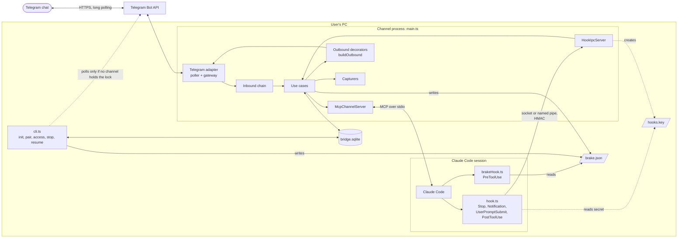
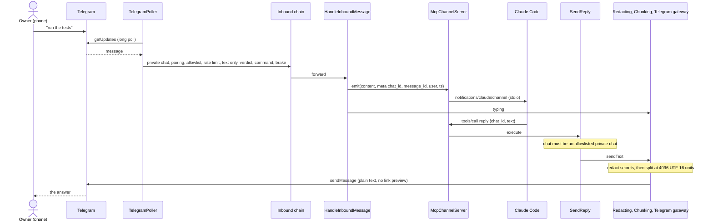

# Architecture

This describes what the code does today. `docs/plan.md` is the original design (Spanish); where
they differ, this file and the code win. The rules for contributors are in `CLAUDE.md`.

## Layers

Clean architecture with ports and adapters. Dependencies point inward only, and
`bun run check:arch` (`scripts/check-architecture.ts`) enforces the import rules.

| Layer | Path | Contains | May import |
| --- | --- | --- | --- |
| Domain | `src/domain` | Pairing state machine, allowed sender, permission request and its states, risk policy, secret redaction, message splitting, token bucket, brake record, notice policy, capture URL policy, choices (F7), skill frontmatter, attachment policy and inbox retention (F10), the `/diff` path filter, git output parsers and line-boundary cuts (F8), the session status log, its update policy and the tool summary (F9), the chart spec checks and raster limits (F11), the session summary rules and slug, the memory proposal and its lines, and the `## Session notes` merge (F12), voice note limits, transcript cleaning and the voice transcript states (F13) | Nothing outside `src/domain` (no packages, no `node:` or `bun:`) |
| Application | `src/application` | Ports (`ports/`), use cases (`use-cases/`), the inbound chain (`pipeline/`), chat commands (`commands/`), outbound decorators (`outbound/`), hook routing (`hooks/`), permission rendering, button taps (`callbacks/`), choices and skills menus, git buttons and the diff document (`git/`), the pinned status board (`status/`), memory proposal prompts and buttons (`memory/`), voice transcript prompts and buttons (`voice/`), i18n catalog | `src/domain`, `src/application`, `zod` |
| Adapters | `src/adapters/*` | `telegram`, `mcp`, `storage`, `capture`, `chart`, `project`, `git`, `voice`, `ipc`, `session`, `skills`, `cli`, `logging`, `system`, `dev` | Application, domain, and the platform packages |
| Composition | `src/main.ts`, `src/cli.ts`, `src/hook.ts`, `src/brakeHook.ts`, `src/composition/` | Hand-written wiring, no DI container. Larger wiring sits in small factory modules under `src/composition/` that only the entrypoints use | Everything |

Platform-specific APIs (`bun:sqlite`, `Bun.serve`, `node:net`) stay in adapters.

## Ports

Defined in `src/application/ports/` (40 today):

| Group | Ports |
| --- | --- |
| Chat out | `ChatGateway` (text, typing), `PromptGateway` (messages with buttons, edit, answer a tap), `ImageGateway`, `DocumentGateway` (a text file, F8), `StatusMessageGateway` (the pinned status: silent send, edit, pin, unpin, one attempt per call, F9) |
| Chat in | `InboundPoller`, `ChannelPort` (event to the Claude Code session) |
| Claude Code | `PermissionVerdictPort`, `SessionController` (interrupt the turn), `SessionActivity` (busy, idle, unknown), `HookEventSource` (events from hooks) |
| State | `AllowedSenderStore`, `PairingStore`, `PermissionStore`, `ChoiceStore`, `AuditLog`, `BrakeFlag`, `BotTokenStore`, `BotIdentityStore`, `PollerLock`, `StatusMessageStore` (F9), `MemoryProposalStore` (F12), `VoiceTranscriptStore` (F13) |
| Files | `AttachmentSource` (download a file sent to the bot), `AttachmentInbox` (the private per-session inbox), `SkillFiles` (read `SKILL.md` files) |
| Project | `GitRepository` (read-only work tree status and diffs, F8), `SessionSummaryStore` (`docs/sessions/`, never overwrites) and `ProjectMemoryFile` (approved lines into `CLAUDE.md`), both F12 |
| Telegram identity | `BotIdentityProbe`, `PairingLinkBuilder` |
| Capture | `ScreenCapturer`, `CaptureScratch`, `ChartRenderer` (F11) |
| Voice (F13) | `Transcriber` (whisper.cpp with ffmpeg, or unavailable with a reason), `AudioScratch` (the private per-note workspace) |
| Security helpers | `SecretHasher`, `RandomSource`, `ProjectSecretsSource` |
| Infrastructure | `Clock`, `Sleeper`, `Logger`, `Terminal` |

## Entrypoints and processes

Four composition roots, each a separate process (plus the chart worker, a child of the channel):

| Entrypoint | Started by | Role |
| --- | --- | --- |
| `src/main.ts` | Claude Code, as an MCP server over stdio | The channel: MCP server, Telegram polling (when it holds the lock), hook listener, permission relay, screenshots, choices and `/skills`, incoming files, `/diff` (read-only git), the pinned status, charts, `/wrap` with its summary and memory tools, and voice notes (ffmpeg and `whisper-cli` as short-lived children, F13). stdout belongs to the MCP transport; logs go to stderr. Exits when stdin closes. |
| `src/cli.ts` | The user (`bun run bridge -- <cmd>`) | `init`, `pair`, `access`, `stop`, `resume`. Owns its terminal. `pair` polls Telegram itself only when no channel process holds the lock. |
| `src/hook.ts` | Claude Code, per event (`Stop`, `Notification`, `UserPromptSubmit`, `PostToolUse`), async | Forwards a signed, trimmed copy of the event to the channel. Node builtins only. Always exits 0, nothing on stdout. |
| `src/brakeHook.ts` | Claude Code, before every tool call (`PreToolUse`), synchronous | Opens `brake.json`. Absent: exit 0 silently. Present or unreadable: prints a JSON object that denies the call and stops Claude. |
| `src/adapters/chart/chartWorker.ts` | The channel, once per `send_chart` (`bun --smol`) | Not a composition root: the chart renderer's process (F11, ADR 0014). Empty environment, the scratch directory as cwd, the spec on stdin, one JSON line out. Loads Vega and resvg, which the channel never imports; killed after 20 s. |

How they communicate:

| Link | Mechanism |
| --- | --- |
| Claude Code and the channel | MCP over stdio (`@modelcontextprotocol/sdk` 1.x): `notifications/claude/channel`, `reply`, `send_screenshot`, `ask_choice`, `send_chart`, `save_session_summary` and `propose_memory` tools, permission request and verdict notifications |
| Channel (or `pair`) and Telegram | HTTPS long polling of `getUpdates` (grammY); only the poller-lock holder polls. Incoming files: `getFile` plus a streamed download, in the background |
| Channel and CLI | Shared SQLite database `bridge.sqlite` (WAL). The poller lock is a heartbeated row (ADR 0006) |
| Hook and channel | Unix socket (Linux, macOS) or named pipe (Windows), one HMAC-signed line per connection (ADR 0008). Never TCP |
| Brake hook, channel and CLI | The file `brake.json`, written atomically by the channel or CLI and read by the hook |

## Component diagram

## Inbound chain

Chain of Responsibility, built in `createInboundPipeline` and `createSessionSteps`. Order, as the
channel process runs it:

1. `PrivateChatOnlyStep`: non-private chats are dropped (log throttled).
2. `PairingClaimStep`: `/start <code>` is the only thing an unknown sender can trigger.
3. `AuthenticateSenderStep`: sender id (`from.id`) must be on the allowlist; otherwise dropped
   silently.
4. `RateLimitStep`: per-sender token bucket.
5. `UnsupportedContentStep`: anything that is not text is refused with one notice per minute;
   photos and documents pass when F10 is wired, voice notes when F13 is.
6. `PermissionVerdictStep` (only when the relay is on): `yes|no <id>` text verdicts.
7. `CommandRouterStep`: registered `/commands` run here; unknown ones fall through.
8. `BrakeGateStep`: while the brake is engaged, nothing is forwarded (or downloaded).
9. `AttachmentStep` (F10): a photo or file starts `ReceiveAttachment` in the background and
   stops here. `VoiceNoteStep` (F13): a voice note starts `ReceiveVoiceNote` (download,
   transcription, the Send/Discard prompt) in the background and stops here.
10. `ChoiceTextAnswerStep` (F7): after "Other…", the next text is tagged with the choice it
    answers.
11. `ForwardToSessionStep` to `HandleInboundMessage`: emits the channel notification.

The `pair` CLI runs only steps 1 to 3. Button taps (`callback_query`) do not use this chain: they
go through `ButtonTapHandler`, which applies its own private-chat, own-chat, allowlist and
rate-limit checks and then routes by prefix: `p1:` to `ResolvePermission` (the only path to a
verdict), `c1:` to `AnswerChoice` (delivers the label with `HandleInboundMessage`), `k1:` to
the `/skills` menu (`RequestSkill` feeds "Use the skill /name" back into this chain as owner
text), `g1:` to `RequestGitAction` (the `/diff` buttons feed a fixed instruction back into this chain as owner text, ADR 0012), `m1:` to `ResolveMemoryProposal` (Approve makes the bridge append the lines to `CLAUDE.md`; the outcome is delivered with `HandleInboundMessage`, ADR 0015), `v1:` to `ResolveVoiceTranscript` (Send feeds the stored transcript into a separate transcript chain: the shared rate limiter, the brake gate, choice answers and delivery, with no command router and no verdict step, ADR 0016). `/wrap` (F12) feeds its fixed instruction into this chain as owner text, like a `/diff` button. Parsers are anchored and strict, so no prefix can reach another route (ADR 0011).

## Outbound decorators

Decorator over the gateways, assembled only in `src/composition/outbound.ts`
(`buildOutbound()`, the only export; the raw `TelegramChatGateway` is constructed nowhere else):

| Kind | Order |
| --- | --- |
| Text | `RedactingChatGateway` then `ChunkingChatGateway` then routing then `TelegramChatGateway` (or `DevChatGateway` for the dev chat) |
| Prompts with buttons | `RedactingPromptGateway` (redact the text and every button label, fit to one message) then routing then Telegram |
| Images | `RedactingImageGateway` (caption redacted and fitted to 1024 characters; the image is not redacted) then routing then Telegram |
| Documents (F8) | `RedactingDocumentGateway` (the whole text redacted, then cut between lines to the cap with a note; caption redacted and fitted to 1024) then routing then Telegram (never the dev chat) |
| Status message (F9) | `RedactingStatusGateway` (redacted, fitted to one message) then routing then Telegram (never the dev chat) |
| Charts (F11) | `RedactingChartRenderer` (every string and key of the spec redacted) then `ProcessChartRenderer`; the PNG then goes out through the image pipeline |
| Memory prompts (F12) | The prompt pipeline with `redaction: 'refuse'` and `overflow: 'refuse'`: a proposal that would be changed or cut is refused, not sent |
| Voice prompts (F13) | The same: a transcript that redaction would change or that does not fit one message gets no Send button |

Redaction runs before chunking so a secret cannot straddle two messages.

## Sequence: message in, reply out

## GoF patterns in the code

| Pattern | Where | Purpose |
| --- | --- | --- |
| Adapter | `src/adapters/telegram/TelegramChatGateway.ts`, `TelegramPoller.ts`; `src/adapters/mcp/McpChannelServer.ts` | Keep grammY and the MCP SDK behind ports |
| Chain of Responsibility | `src/application/pipeline/*Step.ts`, `InboundStep.ts` (`buildPipeline`) | Nothing advances without authentication; each control is tested alone |
| Decorator | `src/application/outbound/RedactingChatGateway.ts`, `ChunkingChatGateway.ts`, `RedactingPromptGateway.ts`, `RedactingImageGateway.ts`, `RedactingDocumentGateway.ts`, `RedactingStatusGateway.ts` | Nothing leaves without redaction |
| Command | `src/application/commands/*Command.ts`, `CommandRegistry.ts`, `createCommandRegistry.ts` | A new command does not touch the router |
| Strategy | `ScreenCapturer` (`src/adapters/capture/HeadlessBrowserCapturer.ts`, `CommandScreenCapturer.ts`); `RiskPolicy` (`src/domain/permissions/RiskPolicy.ts`); `SecretDetector` (`src/domain/redaction/secretDetectors.ts`); `SessionController` (`src/adapters/session/`) | Swap an algorithm without touching the use case |
| State | `src/domain/permissions/permissionStates.ts`, `PermissionRequest.ts`; `src/domain/Pairing.ts`; `src/domain/choices/Choice.ts` | Invalid transitions, such as approving twice, throw |
| Factory Method | `src/adapters/capture/createScreenCapturers.ts`, `src/adapters/session/createSessionController.ts` | Pick the implementation per OS, display server and environment |
| Observer (light) | Callbacks `onSent` on `SendReply` and `onForwarded` on `HandleInboundMessage`, wired in `src/main.ts` and `src/composition/telegramInbound.ts`; `PollingSupervisor` start and stop hooks | Feed notice policy and activity without coupling use cases. The audit log is written directly by the use cases, not through observers |

## State directory

Resolved by `src/adapters/storage/stateDir.ts`: `TELEGRAM_BRIDGE_HOME`, else
`<CLAUDE_CONFIG_DIR or ~/.claude>/channels/telegram-bridge`. Both must be absolute or start with
`~/` (`~` on Windows): the channel, the CLI and the hooks run in different working directories, so
a relative value is refused (`InvalidStateDirError`) instead of resolved against one of them. The
CLI fails with a message, the channel logs it and serves MCP without Telegram, and the brake hook
ignores just that variable and checks the default directory (it must still find a brake). Created with mode 0700; secret files
are 0600 on POSIX (not enforced on Windows, where the profile ACL protects them).

| File | Purpose | Sensitivity |
| --- | --- | --- |
| `.env` | `TELEGRAM_BOT_TOKEN=...` | Secret: full control of the bot |
| `bot.json` | Bot id and username from `getMe` | Not secret |
| `bridge.sqlite` (plus `-wal`, `-shm`) | Allowlist, pairings (hashes of codes only), audit log, poller lock, open permission requests, choices (F7), the pinned status message id per chat (F9), memory proposals (F12), voice transcripts (F13; the text only while pending) | Sensitive: Telegram user ids, audit trail, and while a request or choice is open its description and input preview, or its question and labels |
| `hooks.key` | 32-byte secret for the hook HMAC | Secret: lets a local process forge hook events |
| `hooks.sock` | Unix socket for hook events (Linux, macOS). Falls back to a private directory under `XDG_RUNTIME_DIR` or the temp dir when the path is too long. On Windows a named pipe is used instead and no file exists | Access to it is authenticated by the HMAC |
| `brake.json` | The panic brake flag: who, when, optional reason | Low; a one-line reason may reveal intent. Deleting it releases the brake |
| `tmp/<random>/` | Per-capture scratch directory (image, browser profile; the chart worker's cwd and PNG for F11), removed after each capture | Sensitive while it exists: screenshots and charts |
| `inbox/<session>/<32 hex>.<ext>` | Photos and files sent from the phone (F10), 0600 in 0700 directories; `.part` while downloading. Deleted after 24 h, beyond 200 MB (oldest first), and when another session takes the poller lock | Sensitive: whatever the owner sent |
| `voice/<32 hex>/` | One workspace per voice note (F13): `voice.ogg`, `voice.wav`, `transcript.txt`, 0600 in 0700 directories; removed right after transcription, and stale ones (30 minutes) when the poller lock is taken | Sensitive while it exists: the owner's voice |

The `/skills` command also reads (never writes) `<CLAUDE_CONFIG_DIR or ~/.claude>/skills/*/SKILL.md`
and `<project>/.claude/skills/*/SKILL.md`. `/diff` and the `/status` git line run the read-only
git invocations of `src/adapters/git/gitInvocations.ts` in the project directory (F8, ADR 0012);
nothing is written there by git. F12 writes two kinds of file in the project, always through the
bridge: `docs/sessions/<UTC stamp>-<slug>.md` (created exclusively, never overwritten) and, after
an Approve tap, `CLAUDE.md` (lines appended under `## Session notes`, temp file plus rename). A
link resolving outside the project is refused for both (ADR 0015).
