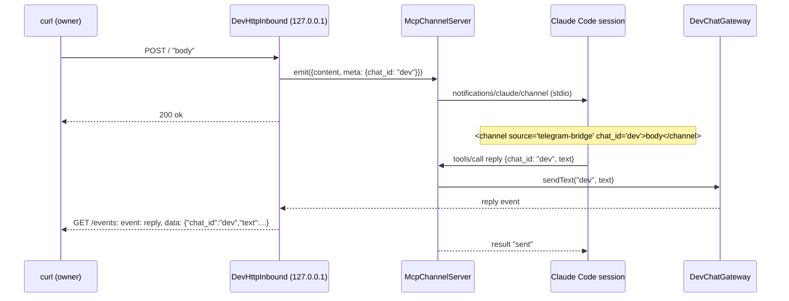

# F0: Skeleton and technical proof

## Objective

Prove the Claude Code channel contract before writing business logic: a minimal channel server
that declares `claude/channel`, exposes a `reply` tool and pushes a test event, plus the project
scaffolding (Bun, strict TypeScript, Biome, architecture check, CI) and answers to the plan's
open questions (`docs/adr/0005-f0-findings.md`).

## Steps

1. Scaffolding: `package.json`, `tsconfig.json`, `biome.json`, `.editorconfig`, `.gitattributes`,
   `.gitignore`, CI on Ubuntu and Windows (`.github/workflows/ci.yml`).
2. `scripts/check-architecture.ts`: fails when `src/domain` or `src/application` import outside
   their allowed layers.
3. Ports in `src/application/ports`: `ChannelPort` (inbound event to the session), `ChatGateway`
   (outbound `sendText`), `Logger`.
4. `src/adapters/mcp/McpChannelServer.ts`: wraps the MCP SDK `Server`, declares
   `experimental['claude/channel']` and `tools`, sets `instructions`, exposes `reply`, emits
   `notifications/claude/channel`, rejects meta keys that are not identifiers.
5. Development-only inbound `src/adapters/dev/DevHttpInbound.ts`, started only when
   `TELEGRAM_BRIDGE_DEV_PORT` is set: binds `127.0.0.1`; `POST /` sends the body to the session
   with `chat_id="dev"`; `GET /events` streams replies (SSE) delivered through `DevChatGateway`.
6. `src/main.ts` wires everything; `.mcp.json` registers the server `telegram-bridge`.
7. Research the open questions from the official docs and record them in ADR 0005.

## Acceptance

- `bun run check` passes on Windows and Linux (lint, typecheck, architecture, tests).
- Automated: `tests/main.test.ts` spawns `bun src/main.ts` over stdio with an MCP client playing
  Claude Code, POSTs to the dev listener, receives the channel notification, calls `reply` and
  reads the reply back from `/events`; stdout carries only JSON-RPC.
- Manual (below): a local `curl` reaches Claude in a real session and Claude's reply comes back
  to the process.

## Sequence



## Manual verification (owner, Windows, interactive session)

Prerequisites: Bun installed, Claude Code signed in with a claude.ai account or Console API key
(channels are not available on Amazon Bedrock, Google Cloud's Agent Platform or Microsoft
Foundry; Team/Enterprise orgs need `channelsEnabled`).

Terminal 1 (PowerShell), from the repository root:

```powershell
bun install
$env:TELEGRAM_BRIDGE_DEV_PORT = "8788"
claude --dangerously-load-development-channels server:telegram-bridge
```

Expect, in order:

1. A full-screen warning about development channels: choose
   **I am using this for local development**.
2. On the first run in this project, "New MCP server found in this project: telegram-bridge":
   choose **Use this MCP server**.
3. A dim notice below the banner:
   `Channels (experimental) messages from server:telegram-bridge inject directly in this session`.
4. `/mcp` lists `telegram-bridge` as connected.

Terminal 2 (watch replies; use `curl.exe`, since `curl` in Windows PowerShell 5.1 is an alias):

```powershell
curl.exe -N http://127.0.0.1:8788/events
```

Expect `: connected`.

Terminal 3 (send a message):

```powershell
curl.exe -X POST http://127.0.0.1:8788/ --data "What is in this directory? Reply to me through the channel."
```

Expect:

- curl prints `ok`.
- Terminal 1 shows an inbound line like `← telegram-bridge: What is in this directory? ...` and
  Claude starts working.
- Claude calls `reply` (`mcp__telegram-bridge__reply`). Approve the permission prompt if asked.
  The terminal shows the tool call and `sent`, not the reply text.
- Terminal 2 prints `event: reply` and `data: {"chat_id":"dev","text":"..."}`.

Also check (results go into ADR 0005 under "Needs live verification"):

- One process per session: with the session open, run
  `Get-CimInstance Win32_Process -Filter "Name='bun.exe'" | Select-Object ProcessId, CommandLine`
  and note the `src/main.ts` processes; open a second session in another terminal and count
  again. If both sessions have `TELEGRAM_BRIDGE_DEV_PORT=8788`, the second server logs
  `dev inbound failed to start` to stderr and keeps serving MCP without a listener. Exit Claude Code and confirm the processes are gone.
- Without the flag: `claude` alone still starts the server (it is in `.mcp.json`), but a POST must
  not reach Claude.
- If the event does not arrive: restart with `claude --debug --dangerously-load-development-channels server:telegram-bridge`
  and read `~/.claude/debug/<session-id>.txt`; if port 8788 is busy, find the holder with
  `Get-NetTCPConnection -LocalPort 8788`.

Unset the variable afterwards with `Remove-Item Env:TELEGRAM_BRIDGE_DEV_PORT`.
