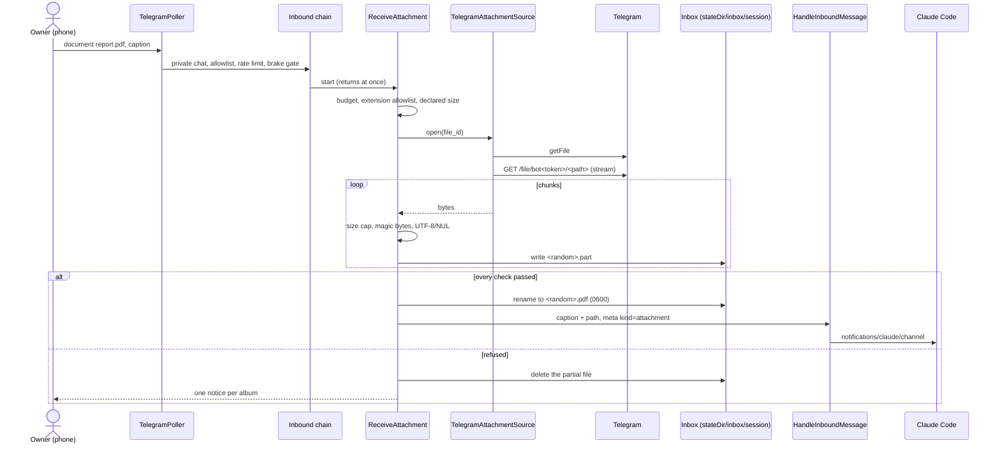

# F10: Incoming images and files

## Objective

Send Claude a photo or a file from the phone. It is saved in a private folder on the PC and
reaches the session as a normal message that names the file's absolute path. Only an allowlisted
owner can do it. Only allowlisted types are kept, and the content must match the extension. The
sender's file name never builds a path. Nothing happens while the brake is engaged. Decisions:
[ADR 0011](../adr/0011-choices-skills-and-attachments.md).

## Steps

1. **Mapping** (`src/adapters/telegram/toInboundMessage.ts`):
   - A `photo` maps to its sizes (file id, width, height, declared size).
   - A `document` maps to its file id, `file_name` and declared size.
   - The caption and `media_group_id` come along.
   - An animation (GIF), which Telegram also reports as a `document`, is not an attachment.
2. **The chain.** Attachments pass the same steps as text: private chat, pairing, allowlisted
   `from.id`, rate limit. Then:
   - `UnsupportedContentStep` lets photos and documents through when F10 is wired. Voice, video,
     stickers and the rest still get the "only text, photos and files" notice.
   - `PermissionVerdictStep` and the commands ignore them, since they have no text.
   - `BrakeGateStep` stops them while braked: nothing is downloaded or forwarded.
   - `AttachmentStep` hands the message to `ReceiveAttachment.start` and returns. The download runs
     in the background, so it never holds up the chat, `/stop` (which has its own lane) or the
     poll loop.
3. **Before downloading** (`ReceiveAttachment`, pure policy in
   `src/domain/attachments/attachmentPolicy.ts`):
   - A per-sender budget: a burst of 10 files, then one every 30 s. Over budget the file is
     refused as `rate_limited`.
   - A photo takes the largest size whose declared size fits the cap. Telegram re-encodes photos
     as JPEG, so the type is `jpg`.
   - A document needs an allowlisted extension (the table below) and a declared size, if any,
     within the cap.
   - The cap is 20 MB (the Bot API download limit), read as 10^6 bytes.
     `TELEGRAM_BRIDGE_MAX_UPLOAD_MB` can lower it (a whole number from 1 to 20). Anything else is
     logged and the 20 MB default is used.
   - Downloads wait in a queue; at most 2 run at a time.
4. **Download** (port `AttachmentSource`, adapter `TelegramAttachmentSource`):
   - `getFile`, then a streamed GET of `https://api.telegram.org/file/bot<token>/<file_path>`
     through an injectable `fetch`.
   - The `file_path` must be plain path segments, with no `..`.
   - A 120 s timeout, and the shutdown signal cancels it.
   - The URL contains the bot token, so it never leaves this class. It is never logged, and every
     error is replaced by a redacted summary (`TelegramCallError`) before it is thrown.
5. **While streaming**:
   - The size cap applies to the bytes actually received, whatever was declared.
   - Once the first 12 bytes arrive, the head is checked. A binary type must start with its magic
     bytes, and a text type must not start like one of the binary types.
   - A text type must be valid UTF-8 (a BOM is fine) without NUL bytes. This is checked chunk by
     chunk with a fatal `TextDecoder`, including a complete last character.
   - An empty file is refused.
6. **The inbox** (port `AttachmentInbox`, adapter `FileAttachmentInbox`):
   - Files go to `<stateDir>/inbox/<session>/`, with directories 0700 and files 0600 (on Windows
     the user-profile ACL protects them).
   - A file is written as `<32 hex>.part` with an exclusive create, then renamed to
     `<32 hex>.<ext>` only after every check passed. A refused or cancelled download removes its
     partial file.
   - Every path is built from our own names. The original name is sanitized metadata only:
     controls, bidi and invisible characters removed, `/ \ : * ? " < > |` replaced, trailing dots
     and spaces dropped, at most 128 characters, `file` when nothing is left.
7. **Delivery** (`HandleInboundMessage`, the same path as typed text):
   - The content is the caption, or "The user sent a photo." or "The user sent a file.", then a
     blank line and `Attachment saved at: <absolute path>`.
   - The meta adds `kind="attachment"`, `attachment_path`, `attachment_name`, `attachment_mime` and
     `attachment_size`.
   - The MCP instructions tell Claude to treat the file as untrusted content.
8. **Refusals.** Every refused file is audited. The chat gets one notice per message, or one per
   album (`media_group_id`), per minute. The notice gives the reason, plus the limit or the accepted
   types where that helps. Each album item is handled on its own.
9. **Retention** (`SweepInbox`, `src/domain/attachments/inboxRetention.ts`):
   - Files older than 24 hours are deleted, then the oldest until the inbox fits 200 MB.
   - The sweep runs when polling starts, after every file kept, and every hour.
   - When this process takes the poller lock, the inboxes of other sessions are deleted (their
     sessions can no longer read them; ADR 0007).
   - `/status` shows the number of files kept and their size.
10. **Shutdown.** `TelegramInbound.stop` stops `ReceiveAttachment` first: the queue is dropped,
    running downloads are aborted, and their partial files are removed.
11. **Audit.** The events are:
    - `attachment.received`: sender id, photo or document, size, allowlisted extension, sniffed
      type;
    - `attachment.refused`: the same fields plus the reason.

    The file name and the caption are never audited.

## Allowlist

| Kind | Extensions | Check |
| --- | --- | --- |
| Images | `png`, `jpg`/`jpeg`, `gif`, `webp` | Magic bytes: PNG signature, `FF D8 FF`, `GIF87a`/`GIF89a`, `RIFF....WEBP` |
| Documents | `pdf` | `%PDF-` |
| Text and data | `txt`, `md`, `markdown`, `json`, `csv`, `tsv`, `log`, `yaml`, `yml`, `toml`, `xml`, `html`, `htm`, `css`, `scss`, `diff`, `patch` | UTF-8, no NUL, does not start like a binary type |
| Source code | `js`, `mjs`, `cjs`, `jsx`, `ts`, `tsx`, `py`, `rb`, `go`, `rs`, `java`, `kt`, `c`, `h`, `cpp`, `hpp`, `cs`, `swift`, `php`, `lua`, `sql`, `sh`, `vue`, `svelte` | Same as text |
| Photos (Telegram `photo`) | stored as `jpg` | JPEG magic |

Not allowed, among others:

- Executables and scripts Windows runs on a double click (`exe`, `bat`, `cmd`, `ps1`, `vbs`,
  `msi`).
- Archives, Office documents and any file without an extension.
- **SVG.** An SVG is an active document. It can carry scripts and event handlers and can load
  external resources. It is XML that sniffs as text, so neither check would reveal what it does
  when opened in a browser or a preview. A raster image is the safe way to send a picture.

## Acceptance

- `tests/acceptance/F10.test.ts` runs the real composition against the fake Bot API, which serves
  `getFile` and the downloads. It uses a plain (not redacting) logger, so the token check proves
  the code, not the safety net. It covers:
  - a photo with a caption: the largest size, our own name, the exact content and meta, 0600/0700
    on POSIX, and the audit without the caption;
  - a hostile document name stored under our name, with nothing written outside the inbox;
  - UTF-8 text accepted; a NUL byte refused;
  - `exe`, `svg` and a name without an extension refused before any download;
  - mismatches (text named `.png`, a PDF named `.txt`, a PNG named `.jpg`) refused, with nothing
    left;
  - the declared size and a lying stream both capped; an empty file refused;
  - voice and video still get the text-only notice;
  - while braked, nothing is downloaded or forwarded; a stranger downloads nothing;
  - an album: each item handled, one notice;
  - the per-sender budget;
  - the bot token never appears in logs, audit rows, events or chat messages, even when the
    download error names the full URL;
  - `/status` shows the inbox; other sessions' inboxes are swept; the TTL sweep;
  - `/stop` works during a stuck download, and shutdown cancels it with no `.part` left.
- Unit tests:
  - the policy, with hostile names (`../../`, absolute and Windows paths, device names, trailing
    dots, RTL override, NUL, reserved characters);
  - sniffing and streaming UTF-8 across chunk boundaries;
  - `maxUploadBytes`;
  - retention;
  - `ReceiveAttachment` with fakes (each refusal, the photo size, in-flight limit, stop);
  - `SweepInbox`;
  - `FileAttachmentInbox` (modes, no leftovers, only our names removed, other sessions);
  - `TelegramAttachmentSource` (streaming, token-free errors, unsafe `file_path`, abort);
  - the media mapping;
  - `UnsupportedContentStep` and `AttachmentStep`.

## Sequence

## Manual verification

1. With the session running, send a screenshot as a photo with the caption "what is this?". The
   session gets the caption and `Attachment saved at: ...\inbox\<session>\<hex>.jpg`. Claude can
   read the file. **[Linux]** `ls -l` shows `-rw-------` and `drwx------`.
2. Send a PDF and a `.md` file as documents: both arrive with `attachment_name` as sent.
3. Send an `.exe` or a `.zip`: a refusal notice, and nothing in the inbox. Rename a text file to
   `.png` and send it: "content does not match its extension".
4. Set `TELEGRAM_BRIDGE_MAX_UPLOAD_MB=1`, restart, send a 2 MB file: "larger than the limit
   (1 MB)".
5. Send an album of three photos: three events (or one notice if refused).
6. `/stop`, send a photo: nothing is downloaded (check the inbox). `/resume`.
7. Send a voice note: the "only text, photos and files" notice.
8. `/status` shows "Received files kept". Quit Claude Code and start a new session: the old
   session's inbox is gone.
9. Search stderr and the audit for the bot token: it never appears. Audit query:
   `attachment.received` and `attachment.refused` rows without names or captions.
