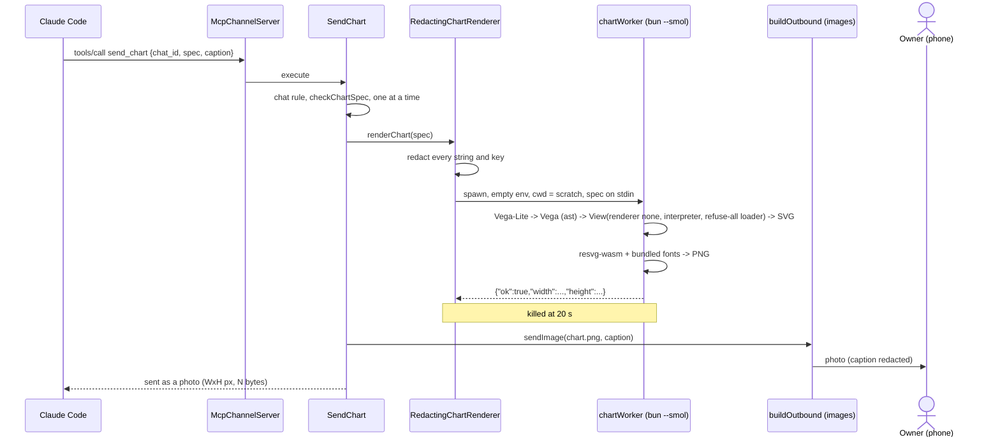

# F11: Charts

## Objective

Let Claude answer with a chart when numbers read better as one. A `send_chart` tool takes a
Vega-Lite spec with inline data and sends the PNG to the chat. There is no browser: Vega draws
to SVG and resvg (WebAssembly) rasterizes it, in a child process that can load nothing and is
killed at a deadline. Decisions: [ADR 0014](../adr/0014-chart-renderer.md). Plan acceptance:
Claude sends a chart and it arrives as a photo.

## Steps

1. **Domain** (pure).
   - `checkChartSpec` (`src/domain/charts/chartSpec.ts`). It refuses:
     - anything that is not a JSON object, and a full Vega spec (`$schema` naming
       `/schema/vega/`);
     - any `url` or `href` key, at any depth;
     - image marks (`mark: 'image'` or `{type: 'image'}`);
     - `sequence` and `graticule` generators;
     - `__proto__`, `constructor` and `prototype` as keys;
     - more than 200,000 bytes, 5,000 inline rows (all `values` and `datasets` together), 60,000
       keys and values, depth 32, or a string or key over 2,000 characters.

     It returns the size and row count, or the problem and a JSON pointer to it.
   - `mapChartStrings`: a deep copy with every string and key mapped (for redaction), never
     producing a prototype key.
   - `chartScale` (`chartImage.ts`): sides up to 2,000 px; scale 2 unless that would pass
     12,000,000 pixels.
2. **Port** `ChartRenderer.renderChart(spec, workspace, signal)` returns the PNG's path and size.
   It rejects with `ChartRenderError` (`invalid_spec`, `too_big`, `timeout`, `failed`).
3. **Outbound.** `buildOutbound({ charts })` wraps the renderer in `RedactingChartRenderer`:
   every string in the spec, keys included, is redacted before the renderer sees it, and the
   count is reported. Text in pixels cannot be redacted later.
4. **Adapter** `ProcessChartRenderer` plus `chartWorker.ts` (`src/adapters/chart/`).
   - `bun --smol chartWorker.ts`, with an empty environment, the capture's private directory as
     cwd, the spec on stdin, one JSON line back (at most 64 KiB) and stderr discarded.
   - Killed after 20 s or on shutdown.
   - The worker loads Vega, Vega-Lite, `vega-interpreter` and `@resvg/resvg-wasm` lazily. It
     locks down `Function`, `eval`, `fetch` and the function constructors, compiles the spec,
     parses it with `ast: true`, and runs a `View` with `renderer: 'none'`, the interpreter and a
     loader that refuses everything (any attempt fails the render).
   - It checks the laid-out size with `chartScale`, rasterizes with the bundled Noto Sans fonts
     on white, and writes the PNG (0600).
5. **Use case** `SendChart`:
   1. The chat must pass `AuthorizeReplyTarget` (the private chat of an allowlisted sender, never
      the dev chat).
   2. `checkChartSpec`.
   3. One chart at a time; another request while one is drawn is `busy`.
   4. A scratch directory from `FileCaptureScratch` (`<stateDir>/tmp/<random>/`), always
      removed.
   5. The PNG is checked (signature, size, 20 MB cap) and sent as a photo, or as a document when
      Telegram would not take it as a photo (`chooseImageDelivery`), named `chart.png`.
   6. The caption is Claude's optional text (sanitized, at most 1,024 characters) followed by a
      note that the image is not redacted beyond its text. The image pipeline redacts and fits
      it.
   7. Audit `chart.sent` or `chart.not_sent`: chat id, spec bytes, rows, outcome and, for a sent
      chart, photo or document, bytes, width, height and redaction count. Never the spec, the
      caption or the renderer's message.
6. **Tool** `send_chart` (`src/adapters/mcp/chartTool.ts`):
   - arguments: `chat_id`, `spec` (an object) and an optional `caption`;
   - listed only with a bot token and the allowlist;
   - the result says the size and the redaction count, or names the problem and the JSON
     pointer;
   - the channel instructions mention it.
7. **Wiring.** `src/composition/charts.ts` and `main.ts`. The channel never imports the chart
   libraries (a test enforces it), and shutdown kills a render in flight.

## Acceptance

- `tests/acceptance/F11.test.ts` uses the real composition, the real renderer process and the
  fake Bot API:
  - A spec becomes a real PNG uploaded with `sendPhoto` to the owner's chat, with a redacted
    caption. The scratch directory is empty afterwards and the audit has sizes only.
  - A token in the spec is redacted before drawing, and the tool result says so.
  - `data.url` (remote and relative), an image mark and a full Vega spec are refused before
    drawing.
  - A stranger's chat is refused.
- `tests/adapters/chart/ProcessChartRenderer.test.ts` starts the real worker:
  - A real render: the PNG signature, the reported size and a title that adds more than 300
    dark pixels (text drawn with the bundled font). The same spec gives the same bytes.
  - No network: an http data URL to a local `Bun.serve` counter, image marks and links get zero
    requests.
  - No files: an absolute path, a `file:` URL and a relative URL (a file placed in the working
    directory) are refused without output.
  - No code: five expressions that try to reach the `Function` constructor never create their
    marker file. Ordinary expressions still evaluate.
  - The deadline: a stub worker that hangs is killed (its pid is gone) and reported as a
    timeout; cancelling kills it too; a stub that floods stdout gives no result.
  - The environment: a variable set in the channel is not visible to the worker.
- `tests/adapters/chart/isolation.test.ts`: only the worker imports the libraries, and lazily.
- Domain, use case and tool tests: `tests/domain/charts/`, `tests/application/use-cases/SendChart.test.ts`,
  `tests/adapters/mcp/f11f12Tools.test.ts`.

## Sequence

## Manual verification (owner, with a token and a paired account)

1. Ask Claude: "Send me a bar chart of the number of files per top-level directory with
   send_chart." Allow the tool when prompted. A photo arrives with the caption note. Record how
   sharp it looks on the phone and how long it took.
2. Ask for a chart whose title contains a fake `ghp_` token: the title shows `[REDACTED]` and
   the tool result says one string was replaced.
3. Ask Claude to chart data from a URL: the tool refuses `url` and asks for inline data. Record
   whether Claude then inlines the data by itself.
4. Ask for two charts at once: one is drawn, the other gets "another chart is being drawn".
5. `<stateDir>/tmp` is empty afterwards. Audit query: `chart.sent` rows with sizes and counts
   only.

## Open points

- Characters outside Latin-1 (CJK, emoji) render as missing glyphs; a larger font set would cost
  megabytes.
- Numbers in the spec are not redacted (only strings); see ADR 0014.
- The worker is a process of the same user, not an OS sandbox.
