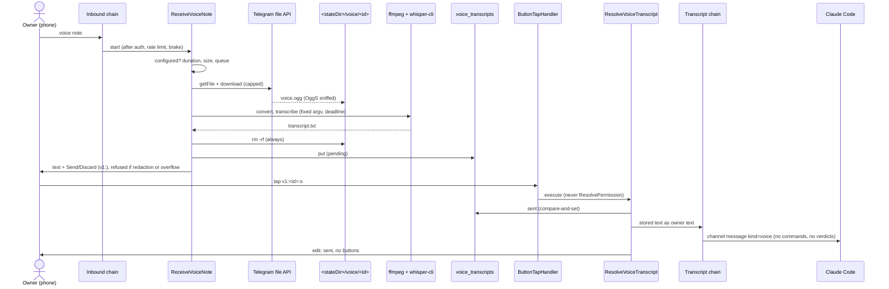

# F13: Voice notes

## Objective

Talk to Claude from the phone. A Telegram voice note is transcribed **on the PC** by whisper.cpp,
the owner sees the exact text with Send and Discard buttons, and only a tapped Send reaches
Claude, as text from the owner. The audio never reaches Claude, never leaves the PC, and is
deleted as soon as it is transcribed. Off until configured. Decisions:
[ADR 0016](../adr/0016-voice-notes.md).

## Steps

1. **The update** (`toInboundMessage`). `message.voice` becomes `voice: {fileId, duration, size}`
   (`duration` and `file_size` are what the sender's client declared). `audio` (music files) and
   `video_note` (round videos) are not mapped and still get the "only text" notice.
2. **The chain.** Authentication, rate limit, supported content (voice passes only when F13 is
   wired), permission verdicts and commands (both skip a message without text), the brake gate
   (braked: the usual "brake engaged" notice, nothing downloaded), then `VoiceNoteStep`.
3. **Before downloading** (`ReceiveVoiceNote.start`).
   - `transcriber.availability()`: not configured, model missing, `whisper-cli` missing or
     `ffmpeg` missing gives a help reply that names the setting (at most one per minute) and
     audit `voice.refused`. Nothing is downloaded.
   - `checkVoiceNote` (domain): a duration that is missing, not finite or over 180 s gives
     `too_long`; a declared size over 2 MB (or the F10 cap, if smaller) gives `too_large`;
     size 0 gives `empty`.
   - One note is transcribed at a time; at most 2 queued (the running one included). A third
     gets `busy`.
4. **Download** (the F10 `TelegramAttachmentSource`). `getFile`'s declared size is checked again;
   the streamed bytes are counted and the download stops past the cap. The bytes go to
   `<stateDir>/voice/<32 hex>/voice.ogg` (directory 0700, file 0600, created `wx`). The first 4
   bytes must be `OggS` (the Ogg capture pattern), else `not_ogg`.
5. **Transcription** (`WhisperCppTranscriber`). Two child processes, fixed argv (below), no
   shell, cwd = the workspace, stdin ignored, stderr discarded, stdout capped at 256 KiB, an
   environment with only `PATH`, `LD_LIBRARY_PATH`, `SYSTEMROOT`, `WINDIR` and the temp
   variables pointing at the workspace (never the bot token).
   - `ffmpeg` converts `voice.ogg` to `voice.wav` (16 kHz, mono, 16-bit PCM): 30 s deadline,
     at most 181 s of audio read, the WAV capped at `181 * 32000 + 4096` bytes.
   - `whisper-cli` writes `transcript.txt`: deadline 60 s + 3 s per second of audio, at most 600 s.
     Exit 0 without a non-empty file is a failure (some `whisper-cli` errors exit 0). The file is
     read up to 64 KiB.
   - A deadline or a shutdown of the channel kills the process (`/stop` does not: the brake
     only stops what reaches Claude).
   - `finally`: the workspace is removed (`rm -rf`), whatever happened. When the poller lock is
     taken, workspaces older than 30 minutes (left by a crash) are removed.
6. **The text** (`cleanTranscript`, domain). CRLF to LF; leading `[hh:mm:ss.mmm --> ...]`
   timestamps and `[BLANK_AUDIO]` removed; lines joined with spaces; controls, escape sequences,
   bidi and zero-width characters removed (`sanitizeDisplayText`). Empty gives `nothing_heard`;
   over 3,500 code points gives `text_too_long`. Never cut.
7. **The prompt** (`VoicePrompts`). A `VoiceTranscript` is stored pending (SQLite
   `voice_transcripts`, schema version 6) and the prompt sent: "🎙️ Transcript of your voice note
   (7 s):", the text, a line saying Send passes exactly this text, and Send / Discard
   (`v1:<id>:s`, `v1:<id>:d`). It is sent with
   `redaction: 'refuse'` and `overflow: 'refuse'`: if redaction would change the text, or it does
   not fit one message, no prompt is sent, the transcript is cancelled and the owner gets
   `contains_secret` or `text_too_long`. Audit `voice.transcribed` (id, declared seconds and
   bytes, bytes received, milliseconds, characters).
8. **The tap** (`ButtonTapHandler`, `ResolveVoiceTranscript`). After the handler's checks
   (private chat, own chat, allowlisted sender, rate limit), the anchored `v1:` parser routes it.
   The use case checks the allowlist again, the session and the chat, then the expiry (10
   minutes).
   - **Send:** braked, the toast says so and nothing changes (Send works again after `/resume`).
     Otherwise claim with compare-and-set, audit `voice.sent` (id, characters), then the stored
     text goes through the **transcript chain**: the shared rate limiter, the brake gate, typed
     "Other..." choice answers (F7), delivery. There is no command router and no permission
     verdict step, so "/stop", "/pair" or "yes abcde" reach Claude as text. The channel message
     has `kind="voice"` and `transcript_id` (or, answering a choice, `kind="choice"`,
     `source="voice"`).
   - **Discard:** CAS, audit `voice.discarded`, nothing sent.
   - The message is edited ("✅ Sent to Claude by ..." or "🗑️ Discarded by ...") and loses its
     buttons; the text is kept on screen. The stored text is erased once the transcript is closed.
   - A second tap only gets a toast.
9. **Expiry** (`ExpireVoiceTranscripts`). The 5 s sweep expires this session's transcripts after
   10 minutes; when the poller lock is taken, other sessions' pending transcripts are cancelled.
   The message loses its buttons. Audit `voice.expired`.
10. **Shutdown.** `stop()` aborts the running transcription (the child is killed), drops the
    queue and waits; the workspace is removed. `/stop` itself never waits for a transcription:
    the transcription runs off the chain.

## External programs

Every flag below is fixed in `src/adapters/voice/voiceInvocations.ts`; an allowlist test fails if
one is added. Only the model path (absolute, not starting with `-`) and the language (`auto` or
2-3 lowercase letters) come from configuration.

`ffmpeg` (docs: https://ffmpeg.org/ffmpeg.html, https://ffmpeg.org/ffmpeg-protocols.html):

```
ffmpeg -nostdin -hide_banner -nostats -loglevel error -protocol_whitelist file
       -f ogg -t 181 -i voice.ogg -map 0:a:0 -vn -sn -dn -map_metadata -1
       -ac 1 -ar 16000 -c:a pcm_s16le -f wav -fs 5796096 -n voice.wav
```

| Flag | Effect |
| --- | --- |
| `-nostdin` | never read stdin |
| `-hide_banner`, `-nostats`, `-loglevel error` | quiet output |
| `-protocol_whitelist file` | "Set a ","-separated list of allowed protocols": only local files, so no URL inside a crafted file is ever opened |
| `-f ogg` (input) | force the Ogg demuxer: no format probing |
| `-t 181` (input) | "limit the duration of data read from the input file" |
| `-i voice.ogg` | the input, relative to the workspace |
| `-map 0:a:0`, `-vn`, `-sn`, `-dn`, `-map_metadata -1` | first audio stream only; no video, subtitles, data or metadata |
| `-ac 1 -ar 16000 -c:a pcm_s16le -f wav` | the format whisper.cpp reads (its README: `ffmpeg -i input.mp3 -ar 16000 -ac 1 -c:a pcm_s16le output.wav`) |
| `-fs 5796096` | "Set the file size limit" |
| `-n` | never overwrite an existing output |

`whisper-cli` (docs: https://github.com/ggml-org/whisper.cpp, README and `examples/cli/README.md`):

```
whisper-cli -m <model> -f voice.wav -l <language> -otxt -of transcript -nt -np
```

| Flag | Effect |
| --- | --- |
| `-m` | the ggml model file |
| `-f` | the input WAV |
| `-l` | spoken language, `auto` to detect (upstream default: `en`) |
| `-otxt` | write a `.txt` result |
| `-of transcript` | the output path without extension (`transcript.txt`, in the workspace) |
| `-nt` | no timestamps |
| `-np` | no progress or extra prints (the transcript still goes to stdout, which is capped and ignored) |

## Configuration

Environment variables of the channel process, like the screenshot settings:

| Variable | Meaning |
| --- | --- |
| `TELEGRAM_BRIDGE_WHISPER_MODEL` | Absolute path of a ggml model. **Required: unset means voice notes are off.** |
| `TELEGRAM_BRIDGE_WHISPER` | Absolute path of `whisper-cli`. Default: `whisper-cli` on `PATH` (looked up once). |
| `TELEGRAM_BRIDGE_WHISPER_LANGUAGE` | `auto` (default) or a code such as `es`, `en`. Anything else falls back to `auto` with a warning in the log. |
| `TELEGRAM_BRIDGE_FFMPEG` | Absolute path of `ffmpeg`. Default: `ffmpeg` on `PATH`. |

A relative or missing override is refused (not replaced by the `PATH` lookup). The old upstream
binary name `main` is never looked up. Changes need a session restart.

## Setup

whisper.cpp's CLI does not read Telegram voice notes directly. The CLI README says "supported
audio formats: flac, mp3, ogg, wav", but its decoder (miniaudio with stb_vorbis in
`examples/common-whisper.cpp`) handles Ogg **Vorbis**, and voice notes are Ogg **Opus** (Bot API,
`sendVoice`: "your audio must be in an .OGG file encoded with OPUS"). Opus is only decoded when
whisper.cpp is built with its optional ffmpeg support (`WHISPER_COMMON_FFMPEG` in that file),
which the bridge does not assume. The main README
also says the CLI "currently runs only with 16-bit WAV files". So **ffmpeg is required**.

Models: `ggml-<size>.bin` from https://huggingface.co/ggerganov/whisper.cpp, or
`models/download-ggml-model.sh <size>` in the whisper.cpp tree. Approximate sizes from the
README: tiny 75 MiB, base 142 MiB, small 466 MiB, medium 1.5 GiB, large 2.9 GiB. Multilingual
models (no `.en` suffix) are needed for Spanish. `base` or `small` is a reasonable start on a CPU.

- **Arch Linux** (verified on archlinux.org, extra repository): `sudo pacman -S whisper-cpp ffmpeg`.
  The package `whisper-cpp` (1.9.5 at the time of writing) installs `/usr/bin/whisper-cli`.
  Download a model, then set `TELEGRAM_BRIDGE_WHISPER_MODEL=/home/<you>/models/ggml-base.bin`.
  Not verified: AUR variants (the AUR page could not be read); an old AUR report mentions a
  binary named `whisper.cpp`, in which case set `TELEGRAM_BRIDGE_WHISPER`.
- **Other Linux:** ffmpeg from the distribution. whisper.cpp from the distribution if packaged
  (not verified per distribution), or built from source as the README says
  (`cmake -B build && cmake --build build -j --config Release`, binary `build/bin/whisper-cli`),
  then `TELEGRAM_BRIDGE_WHISPER=/abs/path/build/bin/whisper-cli`.
- **macOS** (verified on formulae.brew.sh): `brew install whisper.cpp ffmpeg`. The
  `whisper.cpp` formula (formerly `whisper-cpp`, 1.9.5) installs `whisper-cli` and does not
  depend on ffmpeg.
- **Windows** (not verified): build with CMake as above (the binary is
  `build\bin\Release\whisper-cli.exe`) or use a release archive from
  https://github.com/ggml-org/whisper.cpp/releases (asset names not checked), and an ffmpeg
  build (ffmpeg.org lists Windows builds). Set both paths explicitly:
  `TELEGRAM_BRIDGE_WHISPER=C:\tools\whisper\whisper-cli.exe`,
  `TELEGRAM_BRIDGE_FFMPEG=C:\tools\ffmpeg\bin\ffmpeg.exe`,
  `TELEGRAM_BRIDGE_WHISPER_MODEL=C:\models\ggml-base.bin`.

## Limits

| Limit | Value |
| --- | --- |
| Declared duration | 180 s (missing duration refused) |
| Declared and received size | 2 MB, or the F10 cap if smaller |
| Audio read by ffmpeg | 181 s |
| WAV | 5,796,096 bytes |
| Conversion deadline | 30 s |
| Transcription deadline | 60 s + 3 s per second, at most 600 s |
| Child stdout | 256 KiB |
| Transcript file read | 64 KiB |
| Transcript shown | 3,500 code points (one message), never cut |
| Queue | 1 running + 1 waiting |
| Confirmation | 10 minutes |
| Stale workspace | 30 minutes |

## Acceptance

- `tests/acceptance/F13.test.ts`, with the real composition, the fake Bot API and stub
  `ffmpeg`/`whisper-cli` scripts run through Bun:
  - not configured: help reply, no `getFile`, no download, no process;
  - happy path: prompt with the text and `v1:` buttons, the workspace already empty, Send
    forwards the text once with `kind="voice"`, the buttons go, a second tap changes nothing,
    the audit and log hold no words, the stored text is erased;
  - Discard sends nothing; an expired transcript loses its buttons and a late Send sends nothing;
  - a transcript with a token gets no prompt (`contains_secret`), the token is in no audit row
    or log line;
  - transcripts "/stop" and "/pair" are forwarded as text: no brake, no pairing; "yes abcde" is
    not a permission verdict;
  - braked: Send gets the brake toast and stays pending; a new note is not transcribed;
  - too long and too big are refused before `getFile`; a non-Ogg file is refused after the
    sniff and deleted; a failed whisper deletes the audio;
  - with `whisper-cli` hanging, `/stop` engages the brake and answers at once; shutdown kills
    the process and removes the workspace.
- Adapters: `tests/adapters/voice/` (argv allowlist, setup resolution, the scratch directory,
  the transcriber against the stubs: cwd, files, scrubbed env, failures, output caps, the kill
  on timeout and on cancel), `tests/adapters/storage/SqliteVoiceTranscriptStore.test.ts`, the
  voice mapping in `tests/adapters/telegram/telegramAdapters.test.ts`.
- Domain and application: `tests/domain/voice/voice.test.ts`,
  `tests/application/use-cases/voiceUseCases.test.ts` (callback data, the use cases, the
  pipeline steps, `v1:` routing never reaching `ResolvePermission`).

## Sequence



## Manual verification (owner, with a token, a paired account and whisper.cpp installed)

1. Without `TELEGRAM_BRIDGE_WHISPER_MODEL`, send a voice note: the help reply names the setting.
2. Configure it (`auto` language), restart, send a 5 s note in Spanish: record the time to the
   prompt, the transcript quality, the language detected.
3. Send: Claude gets the text; record whether it treats it as a voice transcript. Discard
   another: nothing reaches Claude.
4. Say "barra stop" or a sentence starting with "/stop" if whisper writes it so: nothing is
   executed; Claude gets text. Record whether Claude Code treats a `/name` in channel content as
   a slash command (open since F7).
5. `/stop`, then Send: the brake toast. `/resume`, Send: delivered.
6. A note longer than 3 minutes: refused at once. Leave a prompt 10 minutes: "Expired".
7. `ls <stateDir>/voice` after each note: empty. Audit query: `voice.*` rows with counts only.
8. On Windows: the same with explicit paths; record the release asset used.

## Open points

- Whether Claude Code runs a `/name` in channel content as its own slash command is unverified
  (the same open item as F7's choice answers). The bridge never runs it.
- The duration and size are what the sender's client declares; the received bytes are capped,
  and ffmpeg reads at most 181 s, so a lie only costs one capped conversion.
- whisper.cpp and ffmpeg parse untrusted audio. They run with a scrubbed environment and
  deadlines, but without a sandbox; keep them updated.
- A transcript can be wrong. Claude is told it may contain recognition mistakes.
