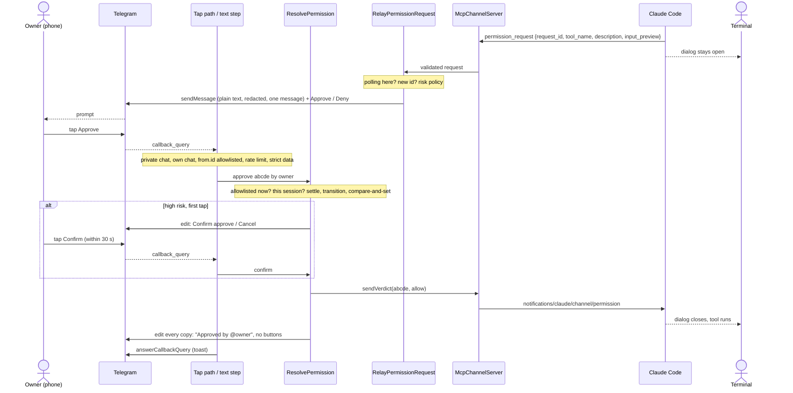
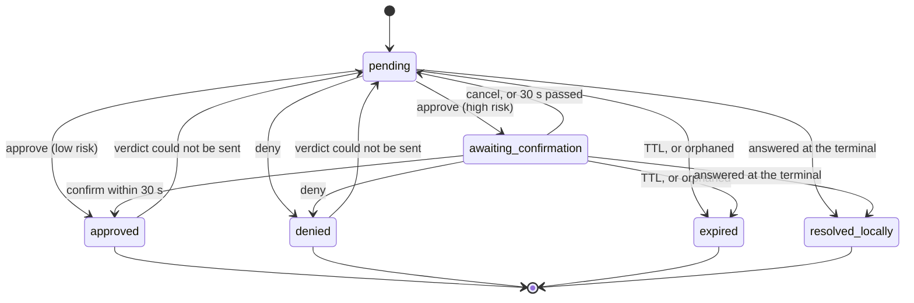

# F3: Permission relay with buttons

## Objective

Approve or deny Claude Code's tool approvals from the phone. When a permission dialog opens in the
terminal, the channel posts the request to every allowlisted sender with **Approve / Deny**
buttons; a tap from an allowlisted account sends the verdict back to the session, and the dialog
closes. The terminal dialog stays open the whole time and remains authoritative: whichever answer
arrives first wins. Destructive-looking requests need a second tap.

Contract (channels reference, "Relay permission prompts", re-checked 2026-11-13; see also
ADR 0005): the server declares `capabilities.experimental['claude/channel/permission']: {}`;
Claude Code sends `notifications/claude/channel/permission_request` with `request_id` (five
letters `a`-`z` without `l`), `tool_name`, `description`, `input_preview`; the server answers with
`notifications/claude/channel/permission` carrying `request_id` and `behavior` (`allow` | `deny`).
Unknown or repeated ids are dropped by Claude Code; there is no signal when the terminal answers
first.

## Steps

1. **Capability** (`src/adapters/mcp/McpChannelServer.ts`). Declared only when the bridge can
   authenticate senders: a bot token and an open state directory (`main.ts`,
   `permissionRelay`). The dev HTTP listener never gets it. Requests are validated with zod
   (`request_id` must match `^[a-km-z]{5}$`, `tool_name` 1-256 characters, the two texts at most
   64 KiB); anything else is ignored and logged by field name only. Verdicts go out through the
   `PermissionVerdictPort`, which refuses a malformed id or behavior.
2. **Domain** (`src/domain/permissions/`).
   - `PermissionRequest`, with the GoF State pattern in `permissionStates.ts`:
     `pending -> approved | denied | resolved_locally | expired`; for high risk
     `pending -> awaiting_confirmation -> approved`, falling back to `pending` after 30 s
     (`CONFIRMATION_WINDOW_MS`, applied by `settle`). A verdict that could not be sent takes
     `approved | denied` back to `pending` (`deliveryFailed`). Any other transition throws
     `InvalidPermissionTransitionError`. It records who decided and when, and a revision used as a
     compare-and-set token. TTL: `PERMISSION_TTL_MS` = 10 minutes.
   - `RiskPolicy` (GoF Strategy) and `PatternRiskPolicy`: a table of rules over `input_preview`
     (see "Risk rules"). Any match makes the request `high`.
3. **Relay** (`RelayPermissionRequest`). Only the process that polls Telegram relays (taps reach
   only it); otherwise nothing is sent and the terminal is the only way to answer. A repeated id
   of this session, or one still open in another, is ignored. The request is stored, then one
   message per allowlisted sender: tool, risk, description, input preview and request id, plain
   text (no `parse_mode`, link previews off), with the buttons. The text is fitted to a single
   message (description at most 600, the preview gets the rest of a 3,500 budget; long values keep
   head and tail around `…`), then goes through `RedactingPromptGateway`, which redacts and, if
   redaction made it longer, fits it again to 4,096. It is never chunked: the buttons sit on the
   message that shows the request. The message ids are stored to edit every copy later.
4. **Taps** (`PermissionCallbackHandler`, the authenticated path for `callback_query`). Private
   chat only, the chat must be the sender's own, `from.id` allowlisted now (`AuthorizeSender`),
   then a per-sender token bucket. A tap failing the first checks is dropped without even an
   answer (throttled log line). Allowlisted taps are always answered so the spinner stops.
   Button data is `p1:<request id>:<a|d|c|x>` (approve, deny, confirm, cancel; 10 bytes, Bot API
   limit 64) and is parsed with a strict regex; anything else is answered with nothing.
5. **Resolve** (`ResolvePermission`). Checks the allowlist again, that the request exists and
   belongs to this session, applies `settle`, then the transition. The new state is stored with
   compare-and-set first (a double tap, two copies tapped at once or a racing expiry cannot yield
   two verdicts), then the verdict is sent; if sending fails the request returns to `pending`
   (audited `permission.verdict_failed`). Every copy is edited: outcome line (who, when, ✅/❌) and
   no buttons. High risk: Approve swaps the keyboard to **Confirm approve / Cancel**; Confirm within
   30 s sends `allow`; after that the buttons go back to Approve / Deny. A tap on a closed request
   gets an "already resolved" or "expired" toast and changes nothing.
6. **Text fallback** (`PermissionVerdictStep`, in the inbound chain after authentication, rate
   limit and the text-only check, before commands). `^\s*(y|yes|n|no|si|sí)\s+([a-km-z]{5})\s*$`,
   case-insensitive, id lowercased and re-checked. A match naming a request of this session is a
   verdict and is not forwarded to Claude; a match naming no request ("no puedo") is forwarded as a
   normal message. High-risk requests cannot be approved by text: the sender is told to use the
   buttons. Denying by text works.
7. **Expiry** (`ExpirePermissions`). A 5 s timer (`PERMISSION_SWEEP_MS`, injected `Every`, fake
   clock in tests) expires this session's requests older than the TTL and reverts timed-out
   confirmations. No verdict is ever sent on expiry. Each time this process takes the poller lock,
   open requests of other sessions are expired at once (`expireOrphans`): they can no longer be
   answered from the chat. On a normal start this is exactly "leftovers of the previous process".
8. **Answered at the terminal** (`MarkPermissionResolvedLocally`). Closes the oldest open request
   with that tool name (and, optionally, an input fragment) as `resolved_locally` and removes its
   buttons. Exposed and tested only; F4 calls it from the `PostToolUse` hook.
9. **Persistence and audit.** `permission_requests` table (migration 2, `user_version`), behind
   the `PermissionStore` port. Description and input preview are kept on disk only while a request
   is open. Audit: `permission.relayed` (tool, risk, matched rule ids, recipients, delivered),
   `permission.confirmation_requested`, `permission.approved` / `permission.denied` (who, tool,
   risk, button or text), `permission.verdict_failed`, `permission.expired` (ttl or orphaned),
   `permission.resolved_locally`. Never the description or the input.
10. **Wiring.** `src/composition/permissions.ts` builds the use cases; `telegramInbound.ts` hooks
    them to the MCP adapter, the chain, the poller (`callback_query` is now in `allowed_updates`)
    and the sweep timer. `/status` shows the number of pending requests.

## Risk rules

Run on `input_preview` (JSON-shaped text; Windows paths show doubled backslashes). They err
towards `high`: a false positive costs one extra tap.

| Rule id | Matches, for example |
| --- | --- |
| `recursive_delete` | `rm -r`, `rm -rf`, `rm -fR`, `rm --recursive`, `rm -f -r` |
| `find_delete` | `find ... -delete` |
| `git_force_push` | `git push --force`, `-f`, `--force-with-lease`, `+refspec` |
| `git_reset_hard` | `git reset --hard` |
| `git_clean_force` | `git clean -f`, `-fd` |
| `sql_drop` | `DROP TABLE / DATABASE / SCHEMA / INDEX / VIEW / USER / ROLE / COLLECTION` |
| `sql_truncate` | `TRUNCATE TABLE x`, `TRUNCATE x;` |
| `sql_delete_without_where` | `DELETE FROM x` followed by `;`, a closing quote or the end |
| `mkfs` | `mkfs`, `mkfs.ext4` |
| `dd_write` | `dd ... of=` |
| `chmod_777_recursive` | `chmod -R 777`, `chmod 777 -R` |
| `pipe_to_shell` | `curl` / `wget` / `iwr` / `irm` ... `\| sh`, `bash`, `iex`, `python`, `node`, `pwsh`... |
| `privilege_escalation` | `sudo`, `doas`, `runas` |
| `shutdown` | `shutdown`, `reboot`, `poweroff`, `halt`, `Stop-Computer`, `Restart-Computer` |
| `powershell_recursive_delete` | `Remove-Item ... -Recurse` |
| `windows_recursive_delete` | `rd /s`, `rmdir /s`, `del /s`, `erase /s` |
| `windows_format` | `format C:` |
| `credential_files` | paths with `.ssh/`, `.aws/`, `.gnupg/`, `.kube/`, `.docker/`, `.azure/`, `.env*`, `.netrc`, `.npmrc`, `.pypirc`, `.git-credentials`, `.pgpass` |
| `elided_input` | `⋯ N code points elided ⋯` (part of the input is not visible) |
| `unserializable_input` | `(value unserializable)` |

Tested negatives include `rm file.txt`, `rm -f build.log`, `git push origin main`,
`git push --follow-tags`, `DELETE FROM users WHERE id = 3`, `chmod 755`, prose such as "drop me a
line" or "truncate the text", `process.env.PORT`.

## The `reply` tool needs its own permission

Claude's `reply` tool is an MCP tool, so in the default permission mode calling it opens a
permission dialog too, which would itself be relayed to the phone before every answer. Allow it
once in Claude Code settings (project `.claude/settings.json` or user `~/.claude/settings.json`).
The permissions docs: "To match one tool, write its full name, `mcp__<server>__<tool>`", and
allow rules for MCP tools are written without a specifier. For this server, named
`telegram-bridge` in `.mcp.json`:

```json
{
  "permissions": {
    "allow": ["mcp__telegram-bridge__reply"]
  }
}
```

When the bridge is installed as a plugin, the server name takes the plugin-scoped form
(`mcp__plugin_<plugin>_<server>__reply`, per the same page); check the exact tool name with
`/mcp` or `/permissions`.

## Acceptance

Automated in `tests/acceptance/F3.test.ts` with the real MCP server (in-memory transport, an MCP
client standing in for Claude Code that sends `permission_request` and records verdicts), the real
grammY poller, SQLite state and composition modules, against the in-process fake Bot API (now with
`callback_query` updates, `answerCallbackQuery` and `editMessageText`). Fake clock, hand-ticked
timer, no network:

- approve: one tap -> one `allow`, buttons removed on the copy, "Approved by @owner", toast;
- deny: one `deny`;
- high risk: Approve -> Confirm / Cancel and no verdict; Confirm -> `allow`;
- double tap (approve, approve, deny) -> exactly one verdict, "already resolved" toasts;
- a stranger's tap and the owner's tap from a group: no verdict, no answer, no edit;
- a revoked sender's old button: no verdict, no answer;
- expiry: no verdict, buttons removed, message annotated, an old tap says "expired";
- `Yes abcde` as text: verdict sent, not forwarded to Claude;
- malformed callback data: answered with nothing, no verdict;
- a `.env` value and a `ghp_` token inside `input_preview` never reach the Bot API, the log or the
  audit;
- `/status` counts pending requests; a leftover of an earlier process expires at startup;
- malformed `permission_request` notifications send nothing.

Unit tests cover every transition, every risk rule (positives and negatives), the callback parser,
each use case, the tap handler, the text step, the decorator, the store and the adapters.
`bun run check` passes.

## Sequence



## States



## Manual verification (owner, with a BotFather token and a paired account)

Use the throwaway state directory from `docs/flows/F1.md` first.

1. **Setup.** Allow `mcp__telegram-bridge__reply` as above. Start
   `claude --dangerously-load-development-channels server:telegram-bridge` in a test project and
   put the session in manual permission mode (`Shift+Tab` until it shows manual mode). stderr
   shows `telegram polling started`.
2. **Approve.** From the phone: "create a file hello.txt containing hi". The terminal shows the
   Write dialog; the phone gets the prompt with tool, risk `low`, the preview and the id. Tap
   Approve: the terminal dialog closes by itself, the file exists, the message shows
   "✅ Approved by @you" and no buttons.
3. **Deny.** Ask for another file; tap Deny. The terminal shows the tool was rejected.
4. **High risk.** Ask Claude to run `rm -r some-scratch-dir`. The prompt says HIGH. Tap Approve:
   the buttons become Confirm approve / Cancel and the terminal is still waiting. Wait 35 s: the
   buttons go back to Approve / Deny. Tap Approve, then Confirm: the command runs.
5. **Double tap.** On a new prompt tap Approve twice quickly: one tool run, the second tap shows
   "already resolved".
6. **Terminal first.** On a new prompt answer at the terminal. The phone keeps the buttons (no
   signal exists; F4 adds `PostToolUse`). A tap now still shows "Approved" in the chat, but Claude
   Code drops the verdict for the closed id and the terminal decision stands. Untouched, the
   message shows "⌛ Expired" after 10 minutes.
7. **Text.** On a low-risk prompt reply `yes <id>` (and once `Sí <id>` with capitals): approved, and
   nothing reaches Claude as a message. On a high-risk prompt, `yes <id>` gets "use the buttons".
8. **Stranger.** A second account never receives prompts. Add the bot to a test group with your
   account, send `yes <id>` there: nothing happens (non-private chats are dropped).
9. **Revocation.** `bun run bridge -- access revoke <your id>` while a prompt is open; tap Approve:
   no answer, terminal still waiting. Pair again afterwards.
10. **Restart.** Leave a prompt open, quit Claude Code, start it again: the old message shows
    "⌛ Expired" without buttons.
11. **Status and audit.** `/status` shows "Pending permission requests". Run the audit query from
    `docs/flows/F1.md`: `permission.relayed`, `permission.approved`, `permission.denied`,
    `permission.expired`; no descriptions, commands or file contents.

## Open points

- **No signal when the terminal answers first.** Buttons stay until expiry (or F4's
  `PostToolUse` hook, which only fires when the tool actually ran; a local denial is still only
  covered by expiry). A tap on such a request sends a verdict that Claude Code drops as unknown.
- **Telegram auto-links URLs in plain text.** No `parse_mode` is used and previews are off, so no
  hidden links or markup can be injected, but a URL in the preview is still tappable.
- **Two sessions.** Only the polling process relays; requests in a second session are answered
  at its terminal only. When polling moves to another process, open requests of the previous one
  expire (ADR 0007).
- Verified against the fake Bot API and an MCP client only: the live behaviour of the terminal
  dialog closing, and the exact sanitized `input_preview` Claude Code sends, need the manual run.
