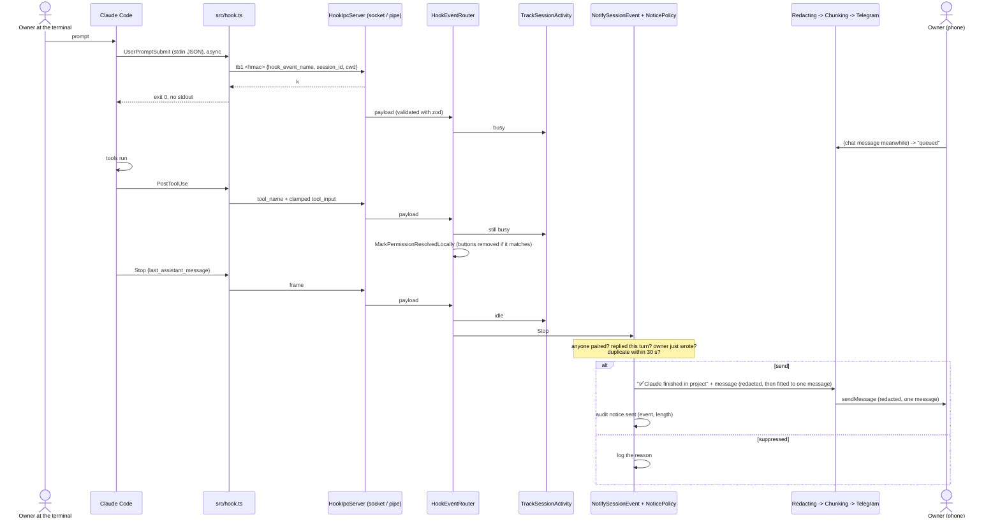

# F4: Notices via hooks

## Objective

Know on the phone when Claude finished or is waiting for an answer, without depending on Claude
calling a tool. Claude Code runs hooks that forward `Stop`, `Notification`, `UserPromptSubmit`
and `PostToolUse` to the running channel over local IPC. The channel then:

- sends "finished" / "needs your answer" notices, with a debounce;
- tracks whether Claude is busy, so F2's "queued" reply finally works;
- removes the buttons of permission prompts answered at the terminal (F3 step 8).

Hook contract (hooks reference, re-fetched 2026-11-14; ADR 0005 (b)):

- `Stop` carries `last_assistant_message`. The notice uses it, not the transcript ("the
  transcript file isn't guaranteed to include the final message at Stop time"), which corrects the
  plan's "tomado de la transcripción".
- `Notification` carries `message`, optional `title` and `notification_type`.
- `UserPromptSubmit` carries `prompt`, which is never forwarded.
- `PostToolUse` carries `tool_name`, `tool_input` and `tool_response`, and only fires when the
  tool ran successfully.
- All of them carry `session_id` and `cwd`.

## Steps

1. **Packaging** (ADR 0009). `.claude-plugin/plugin.json` declares the server; `hooks/hooks.json`
   registers the four events as exec-form hooks:
   `"command": "bun", "args": ["${CLAUDE_PLUGIN_ROOT}/src/hook.ts", "<Event>"]`, with
   `async: true` and `timeout: 5`. The server starts through `start:plugin`, which runs
   `bun install --production` (output to stderr) first.
2. **Hook entrypoint** (`src/hook.ts`). Reads stdin (at most 4 MiB) and keeps only the fields the
   channel uses:
   - `session_id` and `cwd`;
   - `last_assistant_message`, cut at its end to 32,768 characters and flagged
     (`last_assistant_message_truncated`); the channel drops the partial last line before
     redacting (M3; superseded: elided in the middle to 16 KiB);
   - `message` (cut at its end to 4,096 and flagged the same way), `title` and `notification_type`;
   - `tool_name`;
   - the top-level string fields of `tool_input`, each cut to 1 KiB.

   It signs the payload with the shared secret and sends one frame. It always exits 0 with nothing
   on stdout, also when there is no secret (the bridge never ran here), nobody listens, or the
   listener does not answer. The hard deadline is 1.5 s. Diagnostics go to stderr only with
   `TELEGRAM_BRIDGE_DEBUG=1`. It imports only node builtins: about 33 ms cold start without a
   secret and about 42 ms with a full send and ack (dev box, Windows, Bun 1.4.4; `bun -e 0` takes
   19 ms).
3. **Local IPC** (ADR 0008). A Unix socket (0600 in the 0700 state directory, or a short private
   fallback directory when the path is too long) on Linux and macOS; a named pipe
   `\\.\pipe\telegram-bridge-<hash>` on Windows. Each frame is one line carrying an HMAC-SHA256
   with the 32-byte secret from `hooks.key` (0600), capped at 256 KiB, and the server answers `k`.
   Only the poller-lock holder listens (`HookIpcServer` behind the `HookEventSource` port, started
   and stopped by `PollingSupervisor`). Rejected frames are counted and logged by reason only.
4. **Validation and routing** (`src/application/hooks/`). `parseHookEvent` (zod, lenient: unknown
   fields allowed, optional fields may be missing), then `HookEventRouter`:
   - `UserPromptSubmit`: `TrackSessionActivity.turnStarted()`, and the owner counts as having
     just written.
   - `Stop`: `turnEnded()`, then `NotifySessionEvent`.
   - `Notification`: `NotifySessionEvent`.
   - `PostToolUse`: `toolRan()` (still busy), then `MarkPermissionResolvedLocally` with the tool
     name and an input fragment (below).
5. **`NotifySessionEvent`**:
   - **Stop**: "✅ Claude finished in `<project>`." plus the last message, sent to every allowlisted
     sender. `<project>` is the last segment of `cwd`. The whole notice goes to `buildOutbound()`
     with `fitToOneMessage`: it is redacted first, then elided in the middle to one message (M3;
     superseded: elided to 3,500 before redaction, which could leave half a secret visible).
   - **Notification**: "🔔 Claude needs your answer in `<project>`." plus the hook's `message`, for
     `idle_prompt`, `permission_prompt`, `elicitation_dialog`, `elicitation_url_dialog`,
     `agent_needs_input` and payloads without a type. Other types (`auth_success`,
     `elicitation_complete`, `agent_completed`, quota, plugin) and unknown ones send nothing.
   - With nobody allowlisted there are no notices. Each notice is audited as `notice.sent`
     (event, kind, length, recipients, delivered), never with its text.
6. **Debounce**: `NoticePolicy`, a pure domain policy that is passed the time. Constants live in
   `src/domain/notices/NoticePolicy.ts` (see below).
7. **Activity** (`TrackSessionActivity`, the real `SessionActivity`; `UnknownSessionActivity` is
   gone). `UserPromptSubmit` and `PostToolUse` mean busy; `Stop` means idle. A signal older than
   10 minutes (`ACTIVITY_STALE_MS`) reverts to `unknown`, so a crash or a missed `Stop` cannot
   leave "busy" forever. `HandleInboundMessage` reads it before forwarding; when busy, the chat
   gets "queued".
8. **Turn start from the chat.** The docs list what fires `UserPromptSubmit` besides typed
   prompts: scheduled tasks, background subagents, messages from other sessions, Code Mode output.
   Channel messages are not mentioned, so we cannot assume it fires when a chat message starts a
   turn. A forwarded chat message therefore marks the session busy too, but only once some hook
   event has arrived. Without hooks, nothing would ever mark the end of the turn, and every later
   message would wrongly say "queued" for 10 minutes. The mark is made after the busy check, so a
   message never reports itself as queued. If `UserPromptSubmit` does fire for channel turns, the
   two signals agree. **Needs live verification.**
9. **Answered at the terminal.** `PostToolUse` closes the oldest open request of this process with
   the same tool name whose `input_preview` contains the fragment. The fragment is the first 120
   JSON-escaped characters of `command`, `file_path`, `notebook_path`, `url`, `pattern` or `path`,
   escaped the same way the preview escapes them (quotes, Windows backslashes). Without a
   recognizable field it matches by tool name only. A tool that ran without a prompt (allowed by a
   rule) does not close another pending prompt of the same tool unless the fragments match. A
   local denial fires no `PostToolUse`; expiry still covers it.

## Debounce constants

| Constant | Value | Effect |
| --- | --- | --- |
| (rule a) | n/a | No "finished" when Claude sent a `reply` to the chat after the previous `Stop` (that is, during the turn that just ended). |
| `DUPLICATE_NOTICE_WINDOW_MS` | 30 s | The same notice text again within 30 s is dropped. |
| `OWNER_QUIET_MS` | 3 s | No notice of any kind within 3 s of the owner writing: a chat message forwarded to the session, or a prompt at the terminal (`UserPromptSubmit`). The owner is right there. |
| `PERMISSION_NOTICE_COVER_MS` | 15 s | A `permission_prompt` notification is dropped when this session relayed a still-open prompt with buttons in the last 15 s. Claude Code sends it about 6 s after the dialog opens, and F3 already told the owner. |
| (rule d) | n/a | `idle_prompt` (about 60 s after Claude finished) is dropped when the end of that turn was already told, by a "finished" notice or by a reply. Otherwise every task would produce two notices. This is an addition to the brief. |
| `ACTIVITY_STALE_MS` | 10 min | Busy or idle older than this reads as `unknown`. |

## For people not using the plugin

This is the canonical snippet for every hook the bridge ships (F4 notices and the F6 brake); it
mirrors `hooks/hooks.json`. Add it to the project's `.claude/settings.json` (or
`~/.claude/settings.json`), with the absolute path to this checkout. Example for a checkout at
`/home/me/telegram-bridge` (on Windows use `C:/Users/me/telegram-bridge/src/...`). The
`PreToolUse` entry is synchronous on purpose (no `async`): it must be able to refuse the call
(`docs/flows/F6.md`). `onFailure` needs Claude Code v2.1.295 or later.

```json
{
  "hooks": {
    "PreToolUse": [{ "hooks": [{ "type": "command", "command": "bun", "args": ["/home/me/telegram-bridge/src/brakeHook.ts"], "timeout": 5, "onFailure": "continue" }] }],
    "Stop": [{ "hooks": [{ "type": "command", "command": "bun", "args": ["/home/me/telegram-bridge/src/hook.ts", "Stop"], "timeout": 5, "async": true }] }],
    "Notification": [{ "hooks": [{ "type": "command", "command": "bun", "args": ["/home/me/telegram-bridge/src/hook.ts", "Notification"], "timeout": 5, "async": true }] }],
    "UserPromptSubmit": [{ "hooks": [{ "type": "command", "command": "bun", "args": ["/home/me/telegram-bridge/src/hook.ts", "UserPromptSubmit"], "timeout": 5, "async": true }] }],
    "PostToolUse": [{ "hooks": [{ "type": "command", "command": "bun", "args": ["/home/me/telegram-bridge/src/hook.ts", "PostToolUse"], "timeout": 5, "async": true }] }]
  }
}
```

The hooks and the channel must resolve the same state directory: the same `TELEGRAM_BRIDGE_HOME`
or `CLAUDE_CONFIG_DIR` (all inherit Claude Code's environment), absolute or `~/` (a relative value
would name a different directory from each working directory, so it is refused, L3). For the brake this matters most:
a hook that looks in another directory never sees the flag.

## Acceptance

- A task started at the terminal notifies the phone when it finishes, without Claude calling any
  tool. Automated in `tests/acceptance/F4.test.ts` with the real MCP server, SQLite state, grammY
  poller and outbound decorators, against the fake Bot API, with the real `HookIpcServer` on a
  named pipe or Unix socket:
  - a `Stop` event sent through the real `src/hook.ts` child process (exit 0, empty stdout)
    produces exactly one `sendMessage`, plain text, at most 4,096 characters, with a `.env` value
    and a `ghp_` token redacted, and one `notice.sent` audit row without the text;
  - a `reply` during the turn, then `Stop`: no notice;
  - `UserPromptSubmit`, then a chat message: "queued"; after `Stop`, a chat message is not queued;
  - `PostToolUse` with the matching command removes the buttons of a pending prompt ("Answered at
    the terminal"), while another command of the same tool does not;
  - `idle_prompt` notifies; a `permission_prompt` right after F3 relayed the prompt does not.
- `tests/hook.test.ts` spawns the entrypoint in these cases:
  - happy path;
  - nobody listening: exit 0, empty stdout, under 1.2 s;
  - no secret: nothing created;
  - unknown event, garbage stdin;
  - debug only on stderr, without the prompt text;
  - a listener that never acknowledges.
- `tests/adapters/ipc/` covers:
  - framing and authentication (wrong secret, tampering, garbage);
  - oversize, slow client, concurrent clients (handled one at a time), the pending bound,
    handler failure;
  - `in_use`, and restart after stop;
  - a bound address that is a path, not TCP;
  - POSIX only (run on CI's ubuntu): socket 0600 and removed on stop, stale socket of a dead
    process replaced, private fallback directory created 0700 and refused when not private.
- Unit tests cover the policy (fake times), the activity log, payload validation, the router,
  both use cases, the observers on `SendReply` and `HandleInboundMessage`, and
  `PollingSupervisor.onPollingStopped`. They also cover the listener following polling with a
  retry for a busy endpoint.
- `tests/plugin/manifest.test.ts`:
  - structure of `plugin.json` and `hooks/hooks.json`;
  - version in sync with `package.json`;
  - hook events equal to the handled ones;
  - referenced files exist;
  - the hook script imports only builtins.
- `bun run check` passes.

## Sequence



## Manual verification (owner, with a token and a paired account)

Use the throwaway state directory from `docs/flows/F1.md` first. Load the plugin from the checkout
with `claude --plugin-dir <checkout>`, or use the settings snippet above.

1. **Start.** stderr (or `claude --debug`) shows `telegram polling started` and then `listening
   for hook events`. On Linux, `ls -l <stateDir>/hooks.sock` shows `srw-------`. On Windows,
   `[System.IO.Directory]::GetFiles('\\.\pipe\') | Select-String telegram-bridge` lists the pipe.
2. **Finished.** At the terminal ask "list the files here and summarize them". When it ends the
   phone gets "✅ Claude finished in `<project>`." with the summary, once.
3. **No double notice.** From the phone ask for something and let Claude answer with `reply`: no
   "finished" notice follows.
4. **Queued.** Start a long task at the terminal, then write from the phone: the bot answers
   "queued" (**live check of step 8**: also try a long task started from the phone, then a second
   message; it should say "queued" as well).
5. **Needs your answer.** Ask Claude something that makes it wait for input and leave it 60 s
   without a previous notice (for example interrupt a turn with Esc first): the phone gets "🔔
   Claude needs your answer". A Stop notice already sent suppresses the idle reminder.
6. **Permission prompt.** In manual permission mode let a prompt wait: the phone gets the F3
   buttons and no extra "needs your answer" notice after about 6 s. Approve at the terminal: the
   phone's prompt changes to "🖥️ Answered at the terminal" with no buttons.
7. **Fail open.** Quit the channel (or start Claude without it): every hook still exits at once,
   nothing breaks in the session; `TELEGRAM_BRIDGE_DEBUG=1` shows `unreachable` on stderr.
8. **Redaction.** With `DEMO_SECRET=Zq8vR2pL0042` in the project's `.env`, ask Claude to finish
   with "the value is Zq8vR2pL0042": the notice shows `[REDACTED]`.
9. **Audit.** The audit query from `docs/flows/F1.md` shows `notice.sent` rows with event and
   length, no text.

## Open points

- **Needs live verification.**
  - Whether `UserPromptSubmit` fires for turns started by channel messages (step 8).
  - Whether async hooks fire for every event as documented on Windows.
  - The exact `message` texts of `Notification`.
  - That `last_assistant_message` is present on the Claude Code version in use.
  - The plugin items listed in ADR 0009.
- **Multiple sessions.** The MVP is one bot for one session. With the plugin enabled, every
  session's hooks report to whichever process polls. Its notices name the project of the session
  that sent them, so the owner can tell them apart. But busy/idle is one global state: a second
  session's `Stop` can mark the first one idle. The router logs a warning when it sees more than
  one `session_id`. F14 (daemon) owns routing per session.
- **Privacy.** A "finished" notice carries up to one Telegram message of Claude's final message
  (redacted). The planned `privacy: minimal` mode should reduce it to the headline.
- **`/status`** still says busy state cannot be known; it could show the hook-fed state.
- POSIX socket behaviour was verified by tests designed for CI's ubuntu runner, not on the owner's
  Arch machine.
