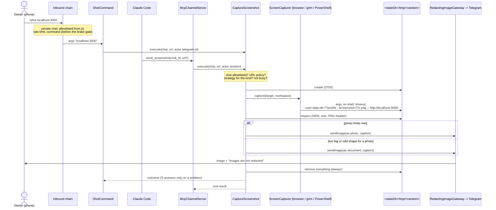

# F5: Screenshots on demand

## Objective

See how the app under development looks from the phone. `/shot` captures the screen and
`/shot <url>` captures a web page (a local dev server included); Claude can send one on its own
with the `send_screenshot` tool. Every image says in its caption that images do not go through
secret redaction. Plan acceptance: `/shot http://localhost:3000` returns the image in the chat.

Deviation from the plan: pages are captured with the installed Chromium-family browser's own
headless mode instead of Playwright (ADR 0010).

## Steps

1. **Domain** (`src/domain/capture/`, pure).
   - `parseCaptureUrl`: only `http:` and `https:`; refuses other schemes (`file:`, `chrome:`,
     `javascript:`, `data:`, `about:`, `view-source:`...), credentials in the URL, whitespace or
     control characters, anything starting with `-`, anything that does not parse, and more than
     2048 characters. A bare `localhost:3000`, `127.0.0.1:8080` or `example.com/x` gets `http://`.
     Loopback and LAN hosts are allowed on purpose (threat model). The result keeps
     `host[:port]` apart, for the audit.
   - `readPngSize`: width and height from the PNG signature and IHDR (24 bytes), no image library.
   - `chooseImageDelivery`: photo, document, too large or empty (limits below).
2. **Ports** (`src/application/ports/`).
   - `ScreenCapturer` (GoF Strategy): `kinds` (`screen`, `url`) and
     `capture(target, workspace) -> { path, mime }`.
   - `CaptureScratch`: a fresh private directory per capture, `inspect` (0600, size, first
     bytes), `dispose` (removes the directory and everything in it, never rejects).
   - `ImageGateway`: `sendImage(chatId, { path, filename, as }, caption)`. Like the text
     gateways it is only built inside `buildOutbound()`: `RedactingImageGateway` redacts the
     caption and fits it to 1024 characters, then the router sends it to Telegram (images never go
     to the dev listener). The image itself is not redacted.
3. **Use case `CaptureScreenshot`** (shared by both entry points, so the limits hold across
   them):
   1. the chat must pass `AuthorizeReplyTarget`, the same rule as `reply` (the private chat of a
      sender allowlisted right now; no dev chat);
   2. the URL policy;
   3. a strategy that covers the kind, else `unavailable` with the reason and what to install;
   4. one capture at a time: a request while another runs is `busy`;
   5. capture into `<stateDir>/tmp/<random 16 bytes>/<random 8 bytes>.png` (directories 0700,
      image 0600); send as a photo or a document with the caption; the directory is always
      removed, on success, failure or timeout;
   6. audit `screenshot.sent` or `screenshot.not_sent`: actor (`telegram:<id>` or `session`),
      chat id, kind, host only for pages (never the path or query), bytes, photo/document, and
      the outcome or reason. Never the URL, the caption or an error text.
4. **Strategies** (`src/adapters/capture/`, GoF Factory Method in `createScreenCapturers`, pure
   over the injected env and probe; every program runs with an argument array, no shell, a
   timeout and an output path we generated):
   - Pages: `HeadlessBrowserCapturer` with the discovered browser (ADR 0010), 45 s.
   - Screen: `CommandScreenCapturer` with the installed tools for this platform, tried in order
     until one exits 0 and leaves a non-empty file, 20 s each. The file is deleted before each
     attempt so a half-written file never counts.
5. **Entry points.**
   - `/shot` and `/shot <url>` (`ShotCommand`, in the registry, so `/help` lists it). It runs
     before the brake gate: it works while `/stop` is engaged (looking is harmless). On success
     the photo is the answer; otherwise one short message.
   - MCP tool `send_screenshot` (`chat_id`, optional `url`), listed only when some strategy exists
     and images can reach Telegram (token and state directory). Refusals and failures are MCP
     error results. The MCP `instructions` mention it and that images are not redacted.
   - `/status` shows `Screenshots: screen, web pages` (or what is available, or none).
6. **F6 follow-up.** `createSessionController` now uses tmux on every non-Windows platform
   (Linux, macOS...) inside a tmux pane.

### Telegram limits (Bot API 10.4, fetched 2026-11-14)

| Limit | Value | Source |
| --- | --- | --- |
| Photo size | at most 10 MB | `sendPhoto.photo`: "The photo must be at most 10 MB in size" |
| Photo dimensions | width + height at most 10000 | "The photo's width and height must not exceed 10000 in total" |
| Photo aspect ratio | at most 20 | "Width and height ratio must be at most 20" |
| Document size | 50 MB | `sendDocument`: "files of any type of up to 50 MB in size"; "Sending files": "10 MB max size for photos, 50 MB for other files" |
| Caption | 0-1024 characters | `caption`: "0-1024 characters after entities parsing" |

MB is read as 10^6 bytes. An image with unknown dimensions (not a PNG) goes as a document. Over
50 MB: not sent, and the chat says so.

### Tools per platform

| Platform | Detection | Screen tools, in order | Exact argv |
| --- | --- | --- | --- |
| Linux, Wayland | `XDG_SESSION_TYPE=wayland` or `WAYLAND_DISPLAY` | `grim` (wlroots: Sway, Hyprland), `spectacle` (KDE), `gnome-screenshot` (GNOME) | `grim <out>`; `spectacle --background --nonotify --fullscreen --output <out>`; `gnome-screenshot --file <out>` |
| Linux, X11 | `DISPLAY` (and not Wayland) | `maim`, `scrot`, ImageMagick `import` | `maim <out>`; `scrot --overwrite <out>`; `import -window root <out>` |
| Linux, no display | neither | none: `unavailable` (`no_display`) | |
| macOS | | `/usr/sbin/screencapture` | `screencapture -x <out>` |
| Windows | `%SystemRoot%\System32\WindowsPowerShell\v1.0\powershell.exe` | PowerShell + `System.Windows.Forms`/`System.Drawing` | `powershell.exe -NoLogo -NoProfile -NonInteractive -EncodedCommand <constant script>`, output path in `TELEGRAM_BRIDGE_SHOT_PATH` |
| Any | `TELEGRAM_BRIDGE_BROWSER`, else known names/paths | pages: Chromium, Chrome, Brave, Edge | see ADR 0010 |

Tool flags were checked against the man pages on man.archlinux.org (spectacle, grim,
gnome-screenshot, maim, scrot) and ss64 (screencapture). ImageMagick's `import -window root`
was not re-fetched. Tools are resolved to absolute paths at startup; installing one later needs
a restart of the session.

The Windows script sets per-monitor DPI awareness (falling back to system awareness), copies the
whole virtual screen (every monitor) with `Graphics.CopyFromScreen` and saves a PNG. It is a
constant, sent base64-encoded with `-EncodedCommand` so no quoting can change it; the output path
never appears in its text.

### Limitations

- **Wayland.** grim needs a compositor with the screencopy protocol (wlroots); KDE and GNOME fall
  through to spectacle or gnome-screenshot. Some compositors show a permission dialog or forbid
  capture to other programs; the dialog appears on the PC, not on the phone, and the 20 s
  timeout ends the attempt. Capturing through the XDG desktop portal is not implemented.
- **The channel must run inside the graphical session** (Claude Code started from a terminal of
  the desktop, so `WAYLAND_DISPLAY`/`DISPLAY` and the session bus are inherited). Started from a
  TTY, over SSH or under a system service, there is no display: only pages can be captured.
- On Windows the capture runs in the user's desktop session; a locked screen or a service
  session yields an error or a black image.
- Pages: only the 1280x800 viewport; 5 s of virtual time for the page to settle (ADR 0010).
- Photos are compressed by Telegram; small text in a big screenshot may be hard to read.
- One capture at a time per channel process.

## Acceptance

- `tests/acceptance/F5.test.ts` with the real MCP server, SQLite state, grammY poller, inbound
  chain, outbound decorators, the capture factory (an Arch box on Wayland: grim and Chromium),
  both real strategies and the real scratch directory, against the fake Bot API (now with
  multipart `sendPhoto`/`sendDocument`). Only the programs are fake: a fake runner writes a real
  small PNG.
  - `/shot http://localhost:3000` from the allowlisted sender: exactly one photo at the fake API,
    with the warning caption and the PNG's bytes; the browser argv ends in
    `-- http://localhost:3000/` and its profile sits in the scratch directory, which is empty
    afterwards; one audit row with the host only.
  - `/shot` runs grim; `/shot` from a stranger: nothing at all.
  - `/shot file:///etc/passwd`, `javascript:`, `chrome://`, credentials: a message, no process.
  - `send_screenshot` to a stranger, a group or `dev`: refused, nothing runs; to the owner: the
    photo.
  - `/shot` works while braked; `/status` and `/help` list it.
- Unit tests: URL policy, PNG header, photo/document decision; browser discovery and the factory
  per platform and environment (exact argv per tool, Windows script and env); the strategies
  with a fake runner (argv, timeout, fallthrough, leftover files, timeouts, URL never a flag);
  the scratch directory (modes on POSIX, removal); the use case (busy, cleanup on capture and
  send failures, audit without the URL, allowlist, revocation, size limits); `/shot`, `/status`,
  the registry; the MCP tool; the caption decorator; the outbound pipeline's multipart upload.
- Smoke tests, skipped unless `TELEGRAM_BRIDGE_SMOKE=1` and never in CI
  (`tests/smoke/F5.smoke.test.ts`): a page served by `Bun.serve` on 127.0.0.1 captured with the
  installed browser, and the native Windows capture. Run on the dev box (Windows 11, Chrome) on
  2026-11-14: page 1280x800, about 11 KB, about 2.2 s; screen 5360x1440 (two monitors), about
  2.6 MB, about 1 s.
- `bun run check` passes.

## Sequence

## Manual verification (owner, with a token and a paired account)

Use the throwaway state directory from `docs/flows/F1.md`; load the plugin with
`claude --plugin-dir <checkout>` (or the settings snippet). Have a dev server running, for
example `bunx serve -l 3000` in some folder.

**Arch Linux, Wayland** (`echo $XDG_SESSION_TYPE` says `wayland`)

1. Install the tool for your desktop: `pacman -S grim` (Sway, Hyprland), `spectacle` (KDE) or
   `gnome-screenshot` (GNOME); and `chromium` (or have Chrome, Brave or Edge).
2. Start `claude` with the channel from a terminal inside the desktop. The channel log (stderr,
   `claude --debug`) shows `screenshot capture {"kinds":["screen","url"]}`.
3. `/status`: `Screenshots: screen, web pages`. `/help` lists `/shot`.
4. `/shot`: a photo of the screen with the caption "📸 Full screen / ⚠️ Images do not go through
   secret redaction...". **Live check**: whether the compositor shows a permission dialog, and
   which tool succeeded (log line `captured the screen {"tool":...}`).
5. `/shot localhost:3000`: a photo of the page, caption with `http://localhost:3000/`.
6. `/shot file:///etc/passwd` and `/shot javascript:alert(1)`: the "only http:// or https://"
   message, no image.
7. Send `/shot` twice quickly: one photo and one "A capture is already running".
8. Ask Claude "send me a screenshot of localhost:3000 with send_screenshot": the photo arrives;
   the tool result says "sent as a photo".
9. `/stop`, then `/shot`: still works; `/resume`.
10. `ls -la <stateDir>/tmp` is empty after every capture; the audit query from
    `docs/flows/F1.md` shows `screenshot.sent` rows with `host` and no path or query.
11. Uninstall or hide the screen tools (or start `claude` from a TTY): `/shot` explains what to
    install; `/shot localhost:3000` still works.

**Arch Linux, X11** (`echo $XDG_SESSION_TYPE` says `x11`)

1. `pacman -S maim` (or `scrot`, or `imagemagick`), then steps 2 to 10 above. The log names
   `maim`.

**Windows 11**

1. Start `claude` with the channel in Windows Terminal. Chrome or Edge is found in its standard
   location (or set `TELEGRAM_BRIDGE_BROWSER` to `chrome.exe`'s full path).
2. Steps 3 to 10 above (`dir %USERPROFILE%\.claude\channels\telegram-bridge\tmp` is empty).
   With several monitors the photo shows all of them; at 125-150 % scaling it is in physical
   pixels, not cut off.
3. Set `TELEGRAM_BRIDGE_BROWSER=C:\nope.exe` and restart: `/shot localhost:3000` says the
   variable is not the path of an existing program.
4. No real screen capture happens in CI; the smoke tests cover both kinds here:
   `$env:TELEGRAM_BRIDGE_SMOKE='1'; bun test tests/smoke`.

## Open points

- **Needs live verification on Arch**: which tool works on the owner's compositor; whether a
  permission dialog appears; that `WAYLAND_DISPLAY`/`DISPLAY` reach the channel process; that
  Chromium's headless capture works there (it did with Chrome on Windows).
- An XDG desktop portal strategy (`org.freedesktop.portal.Screenshot`) would cover GNOME and KDE
  without extra tools; it needs D-Bus and an interactive approval, so it is left out.
- A `PlaywrightCapturer` (full-page captures, wait conditions) can be added as another strategy.
- Leftover capture directories from a crash are not swept at startup (another session may share
  the state directory and be capturing); they are small and private.
