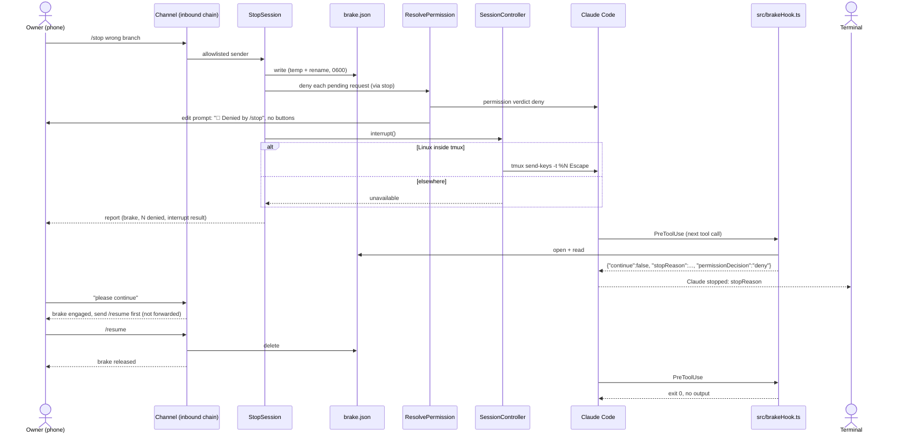

# F6: Panic button `/stop`

## Objective

Stop Claude from the phone, at once. `/stop` engages a brake that a `PreToolUse` hook checks
before every tool call: while it is engaged, no tool runs and Claude stops. Pending permission
prompts are denied, and where possible (tmux on Linux) the running turn is interrupted too.
`/resume` releases the brake. The hook brake is the guarantee; tmux is the improvement
(plan, "Riesgos"). Design and failure policy: ADR 0003 (refined by ADR 0005 (b) and (d)).

Contract (hooks reference, re-fetched 2026-11-14): a synchronous command hook that exits 0 and
prints one JSON object with nothing around it. `hookSpecificOutput.permissionDecision: "deny"`
refuses the call and `permissionDecisionReason` is shown to Claude. Top-level
`"continue": false` makes Claude stop processing, and `stopReason` is shown to the user. Async
hooks cannot block, and a hook that fails or times out does not block unless
`onFailure: "block"`.

## Steps

1. **Flag** (`src/domain/brake/BrakeRecord.ts`, `src/adapters/storage/brakeFile.ts`,
   `FileBrakeFlag.ts`, port `BrakeFlag`). `<stateDir>/brake.json`, 0600, temp file + rename.
   It holds who engaged it (`telegram:<id>` or `terminal`), when, and an optional reason, kept to
   one line of at most 200 characters. Missing: not braked. Present but unreadable or invalid:
   braked.
2. **Hook** (`src/brakeHook.ts`, registered in `hooks/hooks.json` for every tool, synchronous,
   `timeout: 5`, `onFailure: "continue"`). It only opens the flag file: no stdin, no IPC, no
   catalog. When braked it loads the catalog and prints `brakeHookOutput()`
   (`src/application/hooks/brakeHookOutput.ts`).
3. **`/stop [reason]`** (`StopCommand` -> `StopSession`):
   1. `EngageBrake` writes the flag and audits `brake.engaged` (reason length only).
   2. Every open permission request of this session goes through `ResolvePermission` with
      `deny` (`via: 'stop'`): one verdict each, audited `permission.denied`. Every copy of the
      prompt is edited to "🛑 Denied by /stop from @owner" without buttons.
   3. `SessionController.interrupt()`: `sent`, `unavailable` or `failed`.
   4. Audit `session.stopped` (count and interrupt result), then the reply says truthfully what
      happened: brake engaged, how many requests were denied, and whether Escape was sent, or
      that Claude will stop at its next tool call.
   - A second `/stop` reports that the brake was already engaged (since when). It still denies
     anything left pending, and neither interrupts again nor audits again.
4. **While braked.**
   - Chat messages from the owner are not forwarded. `BrakeGateStep` sits after the commands, so
     `/resume`, `/status` and `/help` work, and answers "send /resume first" once per minute.
   - New permission requests get `deny` at once and are not relayed or stored (audited
     `permission.denied`, actor `system`, `via: brake`).
   - Approving a prompt that is still open is refused (`braked`); denying it works. This covers
     `telegram-bridge stop`, which cannot reach the channel's prompts.
   - `/status` shows the brake and since when. F4 notices keep working.
5. **`/resume`** (`ResumeCommand` -> `ResumeSession`): deletes the flag and audits
   `brake.released`. Idempotent. Claude does not resume by itself; the next prompt starts a turn.
6. **Terminal.** `telegram-bridge stop [reason]` and `telegram-bridge resume` use `EngageBrake`
   and `ResumeSession` with actor `terminal`, so the owner can release the brake without the
   phone.
7. **SessionController** (GoF Strategy + Factory Method, `src/adapters/session/`).
   - `createSessionController` picks `TmuxSessionController` on Linux when the channel runs in a
     tmux pane (`TMUX` and `TMUX_PANE` inherited from Claude Code; the pane must match
     `%<digits>`), and `NoopSessionController` everywhere else.
   - Tmux runs `tmux send-keys -t <pane> Escape` through an injected runner: an argument array,
     no shell, a 2 s timeout, that pane only.
   - Windows and macOS get no keystroke injection in this flow (limitation).

## Acceptance

- `tests/acceptance/F6.test.ts`, with the real MCP server, SQLite state, flag file, grammY poller
  and outbound decorators against the fake Bot API, and the real `src/brakeHook.ts` spawned as a
  child process:
  - `/stop` from the allowlisted sender: the flag is on disk, the pending request got exactly one
    `deny` verdict, its prompt lost its buttons, the chat got the report;
  - the PreToolUse entrypoint then prints the deny-and-stop object;
  - a message sent while braked is not forwarded, and a new permission request is denied without
    a prompt;
  - `/status` shows the brake;
  - `/resume`: the hook passes again (empty stdout) and messages flow;
  - a second `/stop` only reports;
  - `/stop` and `/resume` from a stranger: nothing at all.
- `tests/brakeHook.test.ts`: exit code and exact stdout in each state (absent, no state
  directory, engaged, corrupt, not openable, no read permission on POSIX, released) and debug
  output only on stderr.
- `tests/application/hooks/brakeHookOutput.test.ts`: the exact bytes.
- Unit tests:
  - the flag format;
  - the file adapter (atomic replace, no temp file left, 0600 on POSIX, corrupt or oversized
    means engaged);
  - the three use cases;
  - the relay and resolve rules while braked;
  - the gate step and its position in the chain;
  - `/status`;
  - the registry;
  - the CLI commands;
  - the tmux controller with a fake runner (pane validation, exit codes, timeout, missing tmux)
    and the factory per platform and environment. No test starts a real `tmux`.
- `tests/plugin/manifest.test.ts`: the `PreToolUse` hook is synchronous, `onFailure: "continue"`,
  and both hook entrypoints import only builtins.
- `bun run check` passes.

## Sequence

## Failure policy

See ADR 0003. In short:

- **Flag missing, or no state directory: not braked.** A broken install must not brick every
  session.
- **Flag present but unreadable or corrupt: braked**, with a `stopReason` naming the file.
- **The hook process fails** (no `bun`, script missing, crash, timeout): `onFailure: "continue"`,
  so the call goes ahead. The other choice, `block`, would turn any packaging mistake into a dead
  session.
- **A deny verdict cannot be delivered**: that request is not counted as denied and stays
  pending. It cannot be approved from the chat while braked; the terminal dialog is still open.
- **tmux fails or times out**: reported as `failed`; the brake still holds.

## Limitations

- Text generation in progress is cut only inside tmux on Linux; elsewhere Claude stops at its
  next tool call (or ends the turn without one).
- Escape is sent even if Claude happens to be idle (the channel cannot know for sure). The docs
  describe Escape only as stopping the current response; what one Escape does at an idle prompt
  with text typed in it **needs live verification**. One `/stop` sends one Escape, never the
  double Escape that opens rewind.
- The flag is shared by every session that uses the same state directory.
- After `/resume` nothing restarts Claude; send a message or type at the terminal.
- The brake hook and the CLI must resolve the same state directory as the channel
  (`TELEGRAM_BRIDGE_HOME` / `CLAUDE_CONFIG_DIR`).

## Settings without the plugin

The canonical hooks snippet, including `PreToolUse`, is in
[`docs/flows/F4.md`, "For people not using the plugin"](F4.md#for-people-not-using-the-plugin).

## Manual verification (owner, with a token and a paired account)

Use the throwaway state directory from `docs/flows/F1.md`; load the plugin with
`claude --plugin-dir <checkout>` (or the settings snippet).

**Arch Linux, inside tmux**

1. Start `tmux`, then `claude` with the channel in a pane (`echo $TMUX_PANE` in that pane shows
   something like `%0`).
2. Ask Claude for a long task with many tool calls and a long explanation (for example "read
   every file in src and explain each one in detail").
3. From the phone send `/stop testing`. Expect:
   - the reply "🛑 Brake engaged", "There were no pending permission requests" (or N denied) and
     "Sent Escape to the Claude Code terminal (tmux)";
   - the terminal stops the current response at once (Esc);
   - `ls -l <stateDir>/brake.json` shows `-rw-------`.
4. At the terminal type "continue". The first tool call is refused and Claude stops; the terminal
   shows "telegram-bridge: brake engaged from Telegram (...). Claude stopped. Reason: testing. To
   release it ...". **Live check**: the exact rendering of `stopReason`, and that nothing runs.
5. Write "hello" from the phone: the bot says the brake is engaged and nothing reaches Claude.
   `/status` shows "Brake: ENGAGED since ...".
6. In manual permission mode, release (`/resume`), ask for a command that needs approval, wait
   for the prompt on the phone, then `/stop`: the prompt changes to "🛑 Denied by /stop" without
   buttons, and the terminal dialog closes as denied.
7. `/resume`: "Brake released"; "continue" at the terminal works again.
8. At the terminal: `bun run bridge -- stop`, then try a tool in Claude (refused), then
   `bun run bridge -- resume` (works again). The audit query from `docs/flows/F1.md` shows
   `brake.engaged` and `brake.released` with actor `terminal`.

**Windows 11, no tmux**

1. Start `claude` with the channel in Windows Terminal (PowerShell).
2. Ask for a long task, then `/stop` from the phone. The reply says interrupting is not available
   here and that Claude will stop at its next tool call.
3. Watch the terminal: the current text may finish, then the next tool call is refused and Claude
   stops with the `stopReason`.
4. Repeat steps 5 to 8 above
   (`dir $env:USERPROFILE\.claude\channels\telegram-bridge\brake.json` shows the flag).
5. **Corrupt flag.** With the brake released, write garbage into `brake.json`: the next tool call
   is still refused, and the message names the file. `bun run bridge -- resume` deletes it.
6. **Latency.** With `claude --debug`, the `PreToolUse` hook takes a few tens of milliseconds per
   tool call.

## Open points

- **Needs live verification.**
  - The exact effect of `continue: false` from `PreToolUse` on a turn in flight (ADR 0005 (d)).
  - That `TMUX`/`TMUX_PANE` reach the channel process (Claude Code passes its environment to
    stdio MCP servers; plugin servers too).
  - That Escape via `send-keys` interrupts like a real keypress.
  - That a Claude Code older than v2.1.295 accepts the hook with the unknown `onFailure` key.
- macOS could use the same tmux controller; it is left out of this flow on purpose.
